# VLA：从深度学习基础到 π 系列、实时控制、记忆与强化学习

中文图解讲义 · 技术核验日期：2026 年 10 月 25 日 · 面向具有基本编程或深度学习概念的读者

这份讲义沿着“看见世界 → 理解任务 → 生成动作 → 持续执行 → 记住经历 → 从结果改进”的顺序展开。重点不是背论文名称，而是能解释每个模块的输入、输出、训练信号、推理流程以及失败边界。所有插图均为本讲义重新绘制的教学示意图；没有把示意数据当成论文实验结果。

范围说明：详细拆解公开可核实的 π0、π0-FAST、π0.5、知识隔离、π0.6 / π*0.6、MEM、RLT 和 π0.7。公开材料不包含 PI 的全部内部数据与生产配置，因此“详细”指公开机制、公式和工程含义的系统说明，并不声称复现未公开的完整训练系统。模型发布、权重开放和 API 可用是三个不同事实。

阅读约定：标记“原理”的内容是通用解释；“论文事实”指被引用论文中的具体设计；“教学示例”中的数字为便于计算而选；“工程建议”是依据机制提出的实践方案，不代表 PI 官方默认值。正文 [S1] 等编号对应末尾可点击的原始资料。

## 00｜学习路线与全局地图

如果只有 90 分钟：先读第 1、3、5、6、8、10、11、13 章，抓住 VLA、batch、流匹配、π0.5、RTC、MEM、RECAP 的主线。若要做技术分享，按“基础两讲、模型三讲、系统两讲、强化学习两讲、实践一讲”组织。若要动手微调，先完成第 3、4、16、17 章的数据与接口检查，再改超参数。

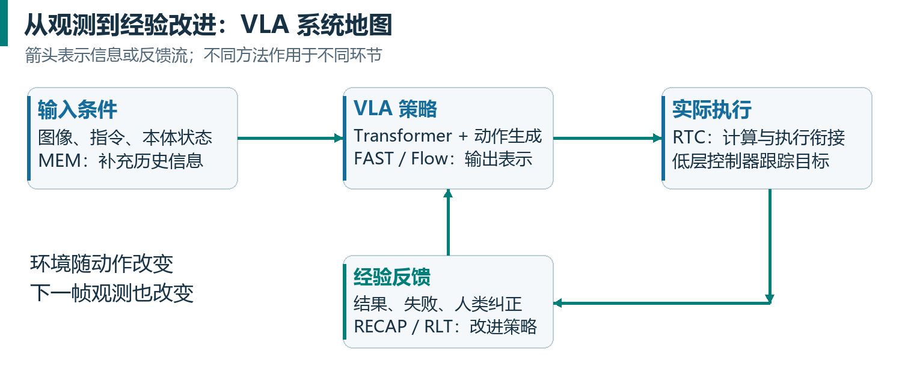

图1把五种机制放在它们真正作用的位置：Transformer 是计算结构；动作表示规定输出是什么；RTC 安排动作何时生成和执行；MEM 提供历史条件；RL 根据执行结果改变未来策略。它们可以互补，但不是把五段代码串起来就自动兼容。

|层次|需要回答的问题|本讲义核心概念|
|---|---|---|
|数据与任务|一次训练样本是什么？|观测、指令、动作块、轨迹、时间戳|
|网络与表示|模型如何混合视觉和语言？|ViT、token、attention、VLM、action expert|
|学习目标|参数如何更新？|交叉熵、行为克隆、flow matching、价值学习|
|部署执行|模型计算时机器人怎么办？|控制周期、异步队列、RTC、截止时间|
|历史依赖|刚刚发生和很久前发生的事如何保留？|视频记忆、文本摘要、部分可观测性|
|经验改进|为什么同样错误不该反复出现？|纠正数据、RECAP、RLT、闭环评测|

## 01｜VLA 到底学的是什么

### 1.1 从分类器到闭环策略

普通图像分类器学习 $x$ → 类别：图像送入网络，输出“杯子”。VLM（Vision-Language Model）能把图像与语言关联，回答“红杯子在桌子的左侧”。VLA（Vision-Language-Action Model）还要输出能够驱动机器人接口的动作，例如下一小段时间内的关节目标和夹爪开合。动作不是一段“我准备拿杯子”的文字。

把一次机器人观测写成 $o_t=\{I_t^{(1)},\ldots,I_t^{(C)},q_t\}$。$I$ 是相机图像，$C$ 是相机数量，$q$ 是本体状态，例如关节角、夹爪宽度、底盘状态。语言任务记为 $l$。策略 $\pi_\theta$ 根据条件生成动作；$\theta$ 是可训练权重，$\pi$ 在这里表示策略，不是圆周率数值。

单步策略：

$$
a_t \sim \pi_\theta(a \mid o_t,l)
$$

动作块策略：

$$
A_t=[a_t,\ldots,a_{t+H-1}] \sim \pi_\theta(A \mid o_t,l)
$$

$H$ 是未来预测步数；每步动作维度为 $d_a$，故 $A_t$ 的形状为 $H \times d_a$。

VLA 仍然属于深度学习。其核心训练仍是前向计算、损失、反向传播、优化器更新。但一旦部署，动作会改变后续观测：抓歪杯子会导致下一张图像发生变化。这种“模型输出改变输入分布”的闭环，是它和静态分类任务最实质的差别之一。

### 1.2 动作空间是接口契约

“7 维动作”不是统一标准。它可能表示末端三维位移、三维姿态增量和夹爪，也可能是 7 个关节目标。双臂、移动底盘、升降机构还会增加维度。对每个维度必须明确：物理量、单位、参考坐标系、绝对值或增量、有效范围、控制周期。错误的单位或坐标系，无法靠多训练几个 epoch 自动修好。

绝对关节目标 $q_{\mathrm{target}}$ 表示“走到这个角度”；动作增量 $\Delta q$（delta）表示“相对指定参考角度改变多少”；关节速度 $\dot q$ 表示“每秒改变多少角度”。动作块（chunk）是一次预测的连续多步动作。

“把动作块转换成增量”必须说明参考点。例如当前关节角为 $q_t=10^\circ$，未来三步绝对目标为 $[12^\circ,15^\circ,14^\circ]$。若三步都减去当前角度，保存的是 $[2^\circ,5^\circ,4^\circ]$；还原时，每个数都加回同一个 $10^\circ$。若保存的是相对上一步的增量，则是 $[2^\circ,3^\circ,-1^\circ]$；还原时必须逐步累加。把第一种数据错误地逐步累加，会得到 $[12^\circ,17^\circ,21^\circ]$，机器人就会走错。训练前的转换与执行前的还原必须采用同一种约定。

VLA 通常输出供低层控制器跟踪的目标。逆运动学、位置伺服、阻抗控制、限速和执行器驱动仍可能由传统控制系统完成。“端到端”通常指观测到动作目标的学习映射，不意味着电机驱动的全部环节都被一个 Transformer 替代。

### 1.3 三种“泛化”必须分开

视觉泛化是光照或背景变了仍识别目标；语义泛化是新指令或新物体含义仍能理解；运动泛化是新姿态、接触条件或机器人仍能成功操作。认识“抽屉”不等于学会在任意把手、摩擦和关节限制下拉开抽屉。互联网视觉语言预训练有助于前两者，机器人数据为动作落地提供关键约束。

还应区分同分布成功、新环境成功、新任务组合成功以及跨机器人成功。一个模型在训练过的桌面上成功，不能直接推出它在新家庭或新机器人上成功。π 系列各代试图推进的泛化维度不同，后文会分别说明。[S1][S2][S4]

## 02｜Transformer、VLM 与多模态前置知识

### 2.1 张量、token、embedding

张量就是带有多层索引的数值数组。“形状”说明每一层索引有多少个位置。下面用方括号列出各轴长度；例如 $[2,3]$ 表示两行、每行三个数，不是把两个数相乘后只得到一个值。

一批多相机彩色图像可以按 $[B,C,H_{\mathrm{img}},W_{\mathrm{img}},3]$ 存放。$B$ 是本批样本数，$C$ 是每个样本的相机数，$H_{\mathrm{img}}$ 和 $W_{\mathrm{img}}$ 是图像高、宽，最后的 $3$ 是红、绿、蓝三个颜色通道。譬如 $[8,3,224,224,3]$ 表示八个样本，每个样本有三张高、宽均为 224 像素的彩色图像。这里特意给图像尺寸加上“img”下标，避免与后面的动作预测长度 $H$ 混淆。不同实现可以调整各轴顺序，但必须说明每个轴的意义。

文本分词后，每个词元（token）先用一个整数编号（ID）表示。一批文本编号的形状为 $[B,L]$：$B$ 条文本，每条占 $L$ 个词元位置；不足的位置按规则补齐。嵌入（embedding）把每个整数编号查表替换成一个长度为 $d_{\mathrm{model}}$ 的向量，于是形状变为 $[B,L,d_{\mathrm{model}}]$。例如 $[8,20]$ 变成 $[8,20,256]$，表示八条文本、每条二十个位置、每个位置用 256 个特征数表示。词元数量仍是二十，不是变成了 256 个词。

token 有两种容易混淆的用法。离散 token 是词表里的整数 ID，例如文字分词或 FAST 动作码；广义 token 是序列里的一个向量槽位，例如图像 patch 的特征或一个连续动作的投影。Transformer 不要求所有输入都先变成离散整数。输入最终都是向量，但生成离散 ID 与直接生成连续向量的损失不同。

图像经 ViT 时先切成 patch，再映射到向量序列。教学示例：$224\times224$ 图像按 $14\times14$ 切分得到 $16\times16=256$ 个 patch；三台相机就可能有 768 个视觉槽位，尚未计文本。这个算例只解释 token 数量，不声明所有 π 模型都使用该输入尺寸或 patch 配置。

### 2.2 一次 attention 在做什么

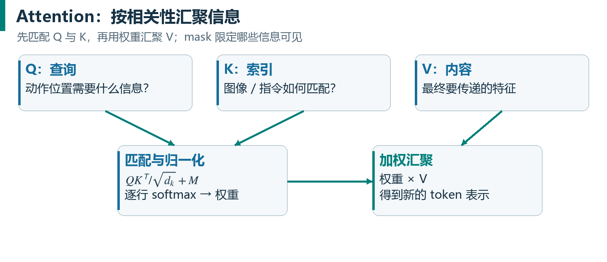

先只看一个样本。输入矩阵 $X$ 的每一行对应一个词元，每一列对应一种特征。设有 $L$ 个词元、每个词元用 $d_{\mathrm{model}}$ 个数表示，则 $X$ 的形状为 $[L,d_{\mathrm{model}}]$。这里 $X$ 是当前样本的数据；$W_Q$、$W_K$、$W_V$ 是训练中学到的三组权重矩阵。

三组权重分别把输入转换成查询（Query）、键（Key）和值（Value）。矩阵乘法写为：

$$
Q=XW_Q,\qquad K=XW_K,\qquad V=XW_V
$$

“线性变换”在这里就是按权重对原特征加权相加。例如输入一行是 $[1,2,3]$，某个输出特征对应的权重是 $[0.5,0,-1]$，那么这个输出数就是 $1\times0.5+2\times0+3\times(-1)=-2.5$。多列权重产生多个输出特征；对全部输入行重复，就得到一个新矩阵。上式为便于讲解省略了某些实现中的偏置项。

在一个注意力头中，$W_Q$ 和 $W_K$ 的形状可为 $[d_{\mathrm{model}},d_k]$，$W_V$ 的形状可为 $[d_{\mathrm{model}},d_v]$。因此 $Q$、$K$ 各有 $L$ 行、$d_k$ 列，$V$ 有 $L$ 行、$d_v$ 列。$d_k$ 是用于比较匹配程度的特征维数，$d_v$ 是最终要汇聚的特征维数；它们不是样本数。

$Q$ 与 $K$ 用于计算“当前位置应多关注哪些位置”；$V$ 提供被汇聚的内容。$K^{\mathsf{T}}$ 表示把 $K$ 的行、列交换。矩阵乘积 $QK^{\mathsf{T}}$ 的形状为 $[L,L]$，第 $i$ 行、第 $j$ 列是位置 $i$ 对位置 $j$ 的匹配分数。除以 $\sqrt{d_k}$ 用于控制分数尺度；加上掩码 $M$ 限制哪些位置可见；softmax 再把每行分数变成总和为 1 的权重。最后用这些权重对 $V$ 的各行加权求和。

$$
\operatorname{Attention}(Q,K,V)=\operatorname{softmax}\!\left(\frac{QK^{\mathsf{T}}}{\sqrt{d_k}}+M\right)V
$$

教学示例：动作 token 想知道目标杯柄在哪，它可能给杯柄视觉 patch 较高权重，也给“拿红杯子”的语言片段权重。但注意力权重不是可靠的因果解释，更不能直接当成模型“真正理由”。多头 attention 是使用多组投影并行汇聚不同关系，拼接后再投影。

Transformer block 还包含前馈网络（MLP）、残差连接和归一化。attention 交换 token 间的信息，MLP 对每个位置进行非线性变换；残差提供直接信息通路，归一化稳定数值尺度。LLM 常用 LayerNorm / RMSNorm，这和 CNN 中依赖 batch 统计的 BatchNorm 不同。因此“小 batch 必然破坏 BatchNorm”不能原封不动套到 Transformer。

位置编码告诉模型顺序或相对位置。文字的先后、图像的空间位置、视频帧的时间、动作块里的未来第几步，都可能需要编码。它们不应混成一个没有语义区分的索引。[S15]

### 2.3 三种注意力掩码

|mask|可读取的信息|典型用途|
|---|---|---|
|双向|同一块内所有位置|图像编码、一个噪声动作块内部互相协调|
|因果|当前位置及过去位置|自回归文本 / FAST token 生成，防止看未来答案|
|分块因果|前一块可见，块内按设计双向或因果|视觉语言前缀 + 连续动作后缀|

掩码必须区分“时间上的未来动作”与“训练时的答案泄漏”。流匹配的整个噪声动作块可以双向交互，因为输入是带噪变量，不是偷偷读取未加噪的真实答案；自回归 token 若能读取未来真实 token，则会形成标签泄漏。联合训练还要防止连续动作分支直接读到教师强制输入的 FAST 答案。

### 2.4 VLM 为什么能帮助机器人

VLM 通常组合视觉编码器、投影 / 融合模块和语言模型。视觉语言预训练使它学到对象、属性、空间关系和指令语义。VLA 在此基础上加入机器人状态、动作表示和动作损失；其核心难点是让原本善于图文理解的表征服务于几何精确、时间敏感的控制。

语言 token 的 next-token prediction（下一 token 预测）使用交叉熵。训练时 teacher forcing 输入真实的前序 token，所有目标位置可并行算损失；推理时真实后文不可得，只能逐个生成。因此“训练并行”与“推理自回归串行”并不矛盾。

KV cache 缓存已算过的 key/value。在一次 flow sampling 内，观测和指令固定时，可以缓存大骨干的前缀表示，反复计算较小动作专家。换了相机观测、指令或记忆，相关缓存通常需重新计算。缓存是计算优化，并不等于能保存长期语义记忆。[S1][S12]

## 03｜batch、step、epoch：与传统深度学习的相同点和不同点

### 3.1 一次 VLA 训练样本是什么

一段 episode 是从任务开始到成功、失败或截断的完整轨迹。训练时常从中选一个时间锚点 $t$，以观测、指令以及未来 $H$ 步动作为一个样本。带历史的模型还取 $t$ 之前若干帧。一次 batch 是多个这样的样本，而不是“一个机器人一次预测的 $H$ 个动作”。

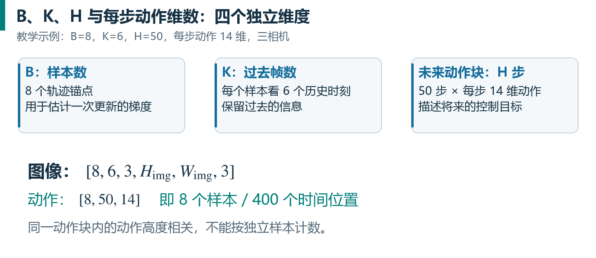

教学示例：$B=8$、三相机、历史 $K=6$、动作 $H=50$、$d_a=14$。图像可表示为 $[8,6,3,H_{\mathrm{img}},W_{\mathrm{img}},3]$，动作标签是 $[8,50,14]$。一批有 8 个锚点窗口，400 个动作时间位置、5,600 个动作标量；并不等价于 400 个相互独立的训练样本。

### 3.2 训练参数逐项对照

|参数|传统深度学习中含义|VLA 中额外需要注意什么|
|---|---|---|
|batch size|一次更新统计多少样本|样本往往是轨迹窗口；窗口之间有强相关性|
|micro batch|一次前后向实际放入显存的样本数|多相机、多历史、高分辨率会显著增大激活开销|
|gradient accumulation|多次反向累计后再更新|必须按有效样本 / token / mask 权重正确归一化|
|step|通常是一次优化器更新|日志中的 step 也可能是 micro step，须读实现|
|epoch|遍历训练集合一次|混合数据、重采样、无限流使 epoch 失去简单含义|
|learning rate|参数更新的尺度|预训练骨干与新动作头可能需要不同学习率|
|warmup / decay|渐增与衰减学习率|改变 batch 后，相同步数代表不同样本预算|
|weight decay|约束参数规模的优化器项|常对 norm、bias 等参数做例外，按实现核对|
|gradient clipping|限制梯度范数|梯度爆炸和数据单位错误都应排查，不能只调阈值|
|dropout|训练时随机丢弃部分信息|还可丢模态、历史、条件，使缺失输入可被处理|
|precision|FP32、FP16、BF16 等|影响数值、显存、速度；推理量化和训练精度不同|
|EMA|对参数做指数移动平均|不是梯度累积，也不是跨动作块平滑|
|loss weights|各目标相对权重|文字、FAST、flow、价值或辅助目标数值尺度不同|
|seed|随机初始化、采样等随机性|机器人初始状态和真实环境仍有额外随机性|

这些术语没有因为模型被称为“大模型”而换了数学含义。变化主要来自模型规模、序列长度、数据相关性、预训练初始化、多目标学习和闭环评价，而非 batch 变成了另一种东西。

### 3.3 有效 batch 的正确计算

纯数据并行且每份数据只被计一次时，有效批量 $B_{\mathrm{eff}}$ 等于每个副本一次前后向处理的样本数 $b$，乘以不同数据副本数 $D$，再乘以梯度累积次数 $G$：

$$
B_{\mathrm{eff}}=b\times D\times G
$$

教学示例：$b=4$，$D=4$，$G=8$，则 $B_{\mathrm{eff}}=128$。每个副本做 8 次前后向后更新一次，优化器看到的平均梯度近似来自 128 个窗口。

如果 8 张卡每 4 张组成一个模型分片组、只有 2 份不同数据副本，$D$ 应取 2，不能直接填 GPU 总数 8。某些 FSDP 配置在全部设备上同时分片与数据并行，计数又不同；判断标准是“一个逻辑更新究竟处理了多少个不重复样本”，而不是显卡数或参数分片数。

梯度累积只在损失归一化、随机操作和状态更新等条件一致时近似大 batch。不同长度文本、不同有效动作维度，若每个 micro batch 简单等权平均，可能不等于全局按有效 token 平均。裁剪通常在累计和同步之后、优化器更新之前完成；混合精度还要考虑缩放梯度的还原。[S17]

### 3.4 step 与 epoch 的算例

假设固定训练集合有 $N=96{,}000$ 个合法窗口，$B_{\mathrm{eff}}=128$，忽略丢尾，则一轮为 750 次优化器更新。训练 15,000 次更新大约相当于 20 轮。总样本呈现次数为 1,920,000，不能说模型见过 192 万条独立机器人轨迹。

把 batch 加倍到 256、仍训练 15,000 步，会把总样本呈现次数加倍；若要保持样本预算，应考虑改为 7,500 步。即使预算相同，梯度噪声、优化器更新频率、学习率调度仍不同，不能保证效果相同。学习率随 batch 线性放大只是某些训练设定中的经验，VLA 微调不能机械照搬。

### 3.5 为什么帧数大不等于信息多

同一条轨迹里相邻窗口共享图像和动作。100 万相邻帧可能比 10 万覆盖更多场景、物体、操作者和失败恢复的帧更单一。有效信息量依赖状态覆盖，而非只看帧数。若随机按帧划分训练和验证，相邻窗口会跨集合重叠，验证损失好看却可能严重高估泛化。

至少按完整 episode 分割；评估新家庭泛化时应按家庭 / 场景分割；评估新物体或机器人时按对应实体分割。先分割，再构造窗口和拟合归一化统计，能避免隐蔽泄漏。测试集不能被用于选 checkpoint 后仍报告成“完全未见”。

### 3.6 训练参数与部署参数分开记

训练 batch 决定梯度统计；推理 batch 决定一次服务多少观测，单机器人通常是 1。$H$ 决定预测长度；$s$ 决定实际执行多少步再接入下一块；$N_{\mathrm{flow}}$ 决定生成一个 动作块的数值积分次数；$f_{\mathrm{ctrl}}$ 是机器人控制频率。增加 $N_{\mathrm{flow}}$ 不会自动增加 $H$，增加 $H$ 也不会让机器人控制器更高频。

教学示例：50 Hz 表示每 20 ms 发一个控制命令；$H=50$ 覆盖 1 秒；$s=10$ 表示理想情况下每 0.2 秒重规划；$N_{\mathrm{flow}}=10$ 表示每次 动作块 生成内部迭代 10 次。这里的“10”分别在真实时间和生成时间上计数，是两个不同循环。

## 04｜从数据到微调：完整学习闭环

### 4.1 行为克隆是监督学习

行为克隆（BC）把示范动作当目标，在数据分布上拟合条件策略。离散动作通常最小化负对数似然；连续高斯回归常对应 MSE；扩散或流匹配使用生成目标拟合动作分布。使用 flow loss 的训练仍可属于模仿学习，因为监督数据来自专家示范，而非奖励反馈。

训练 / 微调是“从哪里开始、更新多少参数”的描述；监督 / 模仿 / 强化学习是“用什么信号与目标”的描述。预训练可以使用监督目标，微调可以使用 BC 或 RL；不能把“微调”理解成某一个固定损失函数。

### 4.2 一份数据应包含什么

每条轨迹需记录图像、本体状态、控制指令、采样时间、episode 边界和任务描述。最好保留真实执行时间、目标时间、相机曝光时间、控制频率与动作语义。训练标签一般来自控制目标或示范命令，不能无条件用下一帧测得的状态代替：测得状态还包含伺服滞后、接触扰动和执行误差。

时间对齐要回答“这张图像对应的是哪条动作发出之前的状态”。如果相机数据比关节数据晚 100 ms，却按相同行号拼在一起，模型可能学习互相矛盾的映射。增加模型规模不会消除这种标注问题。

归一化常用均值 / 标准差，或分位数缩放。例如 $a_{\mathrm{norm}}=(a-\mu)/\sigma$；分位数缩放可把常见范围映射到近似 $[-1,1]$。统计应来自训练集，和 checkpoint 一起保存。夹爪二值通道与连续关节可能需要不同处理，填充维度和无效动作必须有明确 mask 或监督约定。

### 4.3 全量微调、冻结、LoRA

全量微调更新全部允许训练的权重，适应能力强但训练状态占用大，也可能遗忘原有能力。冻结骨干只训练动作相关模块更省优化器显存，但如果视觉表征缺乏机器人任务所需信息，冻结会成为瓶颈。知识隔离则是限制特定梯度路径，后文会说明它并不等于冻结。

LoRA 把一个大矩阵的更新写成 $\Delta W=(\alpha/r)BA$，$W$ 原权重冻结，$A$ 为 $r\times d_{\mathrm{in}}$，$B$ 为 $d_{\mathrm{out}}\times r$，$r$ 远小于矩阵宽度。教学算例：$4096\times4096$ 矩阵有约 1,678 万参数；$r=16$ 的 $A$、$B$ 共 131,072 个参数。减少的是可训练增量和相应优化器状态，不是自动删除大骨干的前向计算或全部激活。

LoRA 的 rank、alpha、插入层、是否同时训练动作专家都会影响结果。它不是特定于语言模型的数学技巧，也不保证比全量微调更准。小数据、显存有限可优先试；任务差异很大或感知需深度适应时，应实证比较。[S16]

### 4.4 一个通用训练 step

```text
取 B 个轨迹窗口，并完成时间对齐与归一化
构造图像 / 文本 / 状态 / 动作，以及有效位置 mask
若是流匹配：采样噪声与生成时间，构造带噪动作
前向计算预测，按目标类型计算 CE / flow 等损失
按有效元素归一化，反向传播并累计梯度
在更新边界同步梯度、必要时裁剪、执行优化器更新
更新 EMA 和学习率调度，记录真实 optimizer step
定期离线验证；按独立协议做真实闭环 rollout
```

训练 loss 降低，意味着对选定数据与损失的拟合改善；它不直接等于任务成功率提高。一个“很接近示范”的夹爪位置仍可能错过接触点，之后误差会积累。早停与模型选择应同时参考离线诊断和闭环指标。

## 05｜动作生成：回归、自回归、扩散与流匹配

### 5.1 为什么不能只预测平均动作

假设绕过障碍有左、右两条有效路线。用单峰 MSE 回归可能得到穿过障碍的平均路线；这说明目标分布存在多峰。生成策略希望从多个合理方案中采样一个自洽动作块。多峰问题存在于动作策略，不只是图像生成。

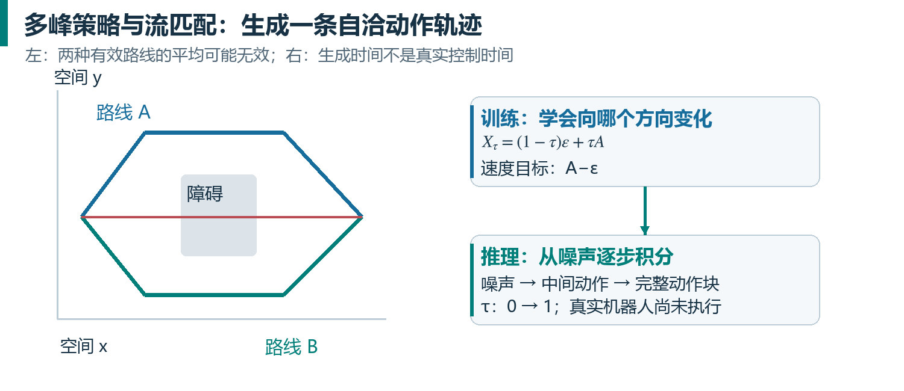

|输出路线|训练目标|推理方式|主要权衡|
|---|---|---|---|
|确定性回归|MSE / L1|一次输出向量|快，但复杂多峰分布可能被平均|
|离散自回归|token 交叉熵|逐 token 生成，再解码|便于语言式学习，但序列可能长|
|扩散策略|预测噪声 / score / 数据等|多步去噪|表达多峰，采样成本依设定变化|
|流匹配策略|回归概率路径的速度场|积分 ODE 生成动作|可连续生成整块，步数影响速度和误差|

扩散与流匹配存在紧密数学联系，但不是简单换名字。噪声路径、预测目标、采样方程及时间方向都需一起说明。某种 flow 模型比某种扩散模型快，不意味着所有 flow 方法都必然更快。[S14][S19]

### 5.2 一条线性概率路径

本讲义统一采用“$\tau=0$ 是噪声，$\tau=1$ 是数据”的教学约定。真实动作块为 $A$，噪声 $\varepsilon\sim\mathcal{N}(0,I)$，构造 $X_\tau=(1-\tau)\varepsilon+\tau A$。沿这条配对路径的速度为 $u=A-\varepsilon$。模型读取 $X_\tau$、$\tau$ 和条件 $o,l$，预测速度 $v_\theta$，并最小化平方误差。

$$
\mathcal{L}_{\mathrm{flow}}=\mathbb{E}\!\left[\left\|v_\theta(X_\tau,\tau,o,l)-(A-\varepsilon)\right\|^2\right]
$$

训练时每个样本可随机取一个 $\tau$；并不需要先做完整十步生成再反向传播。$\tau$ 采样分布可偏向某些噪声程度。最优网络学到的是给定 $X_\tau$ 和条件下的条件平均速度场，而不是知道每个测试噪声对应哪条真实示范。

推理时没有真实 $A$。从 $X_0=\varepsilon$ 出发，反复用 $X_{\tau+\Delta\tau}=X_\tau+\Delta\tau\,v_\theta(X_\tau,\tau,o,l)$ 更新，积分到 1 得到动作块。Euler 只是数值求解方式，更多步可能降低离散化误差，却增加延迟；具体多少步合适要比较任务表现与时延。

### 5.3 一维手算：别把训练目标与部署动作混淆

教学示例：归一化动作 $A=0.8$，噪声 $\varepsilon=-0.4$，$\tau=0.25$，则 $X_\tau=-0.1$，监督速度为 1.2。若模型预测 1.0，单标量平方误差为 0.04。推理时不会直接把“速度 1.0”发给电机，而是把生成空间里的向量用于迭代，最后再将动作反归一化并转换为机器人接口。

这里的 flow velocity 是动作样本空间对生成时间的导数，不一定是机械臂物理速度。真实时间 $t$、生成时间 $\tau$、动作空间物理单位是三件事。把它们混淆，会造成完全错误的控制解释。

### 5.4 论文与 openpi 时间约定的对照

π0 论文使用噪声到动作的 $\tau$ 正向积分。核对的 openpi 代码则令 $t=1$ 是噪声、$t=0$ 是动作：$X_t=t\varepsilon+(1-t)A$，目标是 $\varepsilon-A$，dt 为负，采样从 1 积分到 0。令 $t=1-\tau$ 即可互相转换；两种写法都成立。

错误做法是使用论文的目标 $A-\varepsilon$，却保留代码的负 dt；或者把代码的 $t$ 当成机器人控制步。复现时必须把插值方向、训练速度符号、积分方向作为一组检查。[S1，§IV][S12，pi0.py]


## 06｜π0：把 VLM 接到连续动作世界

### 6.1 先看版本，而不是把所有 π 都画成同一张图

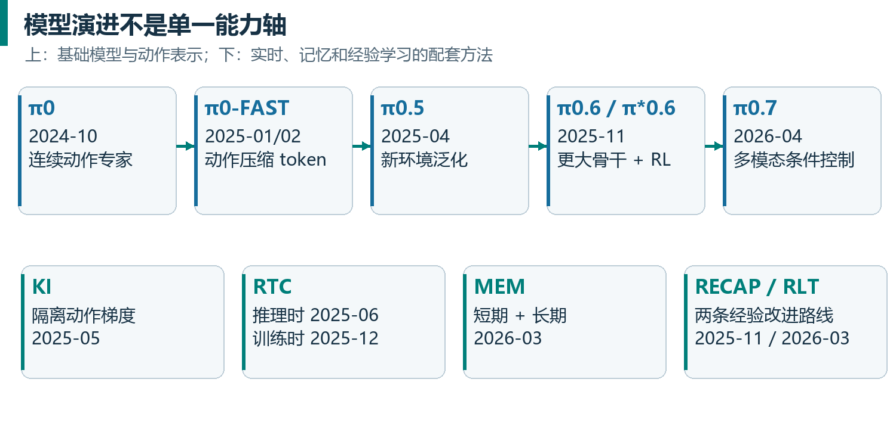

|公开节点|主要变化|它不自动意味着什么|
|---|---|---|
|π0，2024-10|预训练 VLM + 连续 flow action expert|没有声称能解决任意机器人任务|
|FAST / π0-FAST，2025-01/02|压缩动作 token，自回归训练|FAST 名字不代表推理一定更快|
|π0.5，2025-04|异构数据、语义层级、开放环境泛化|不是把 π0 权重简单放大 0.5 倍|
|Knowledge Insulation，2025-05|离散动作表征学习 + 隔离连续梯度|不是冻结整个视觉语言骨干|
|RTC，2025-06|推理时动作前缀约束与异步执行|没有凭空缩短模型计算时间|
|π*0.6，2025-11|π0.6 经 RECAP 从经验改进|星号不是“0.6 版本通用叫法”|
|Training-time RTC，2025-12|训练时学习干净前缀条件|需要适配训练，不是零训练替换|
|MEM，2026-03|短期视频 + 长期文本记忆|上下文适应不等于在线更新权重|
|RLT，2026-03|冻结大模型，在线学习轻量 actor-critic|不是给模型加一个奖励数字就完成 RL|
|π0.7，2026-04|丰富上下文控制与技能组合|论文演示不等于全任务可靠性证明|

时间为官方发布节点，部分 arXiv 版本提交时间与官网日期不同。例如 RLT 官网发布于 3 月，本文检索的 arXiv v1 日期为 4 月。π0.6 基础模型的技术细节在 π*0.6 等论文中给出，不应为了凑时间轴而虚构独立发布日期。[S1-S11]

### 6.2 π0 的前向结构

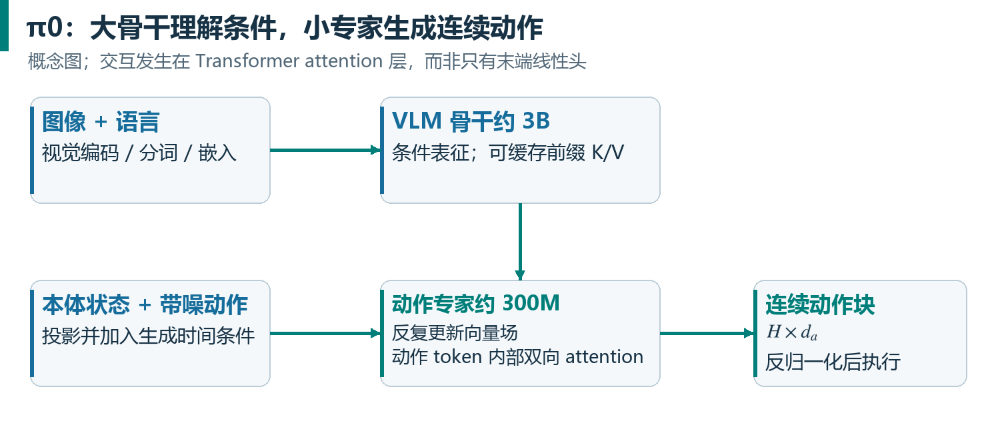

论文事实：π0 从约 3B 参数的 PaliGemma VLM 初始化视觉语言骨干，新增约 300M 的动作专家，总体约 3.3B。视觉与语言 token 使用骨干权重，本体状态与连续动作相关 token 使用动作专家权重；两个部分在 attention 层交换信息。动作专家不是仅接在最后一层的一个线性回归头。[S1，§IV、附录B]

如何理解“expert”：不同模态槽位按预先规定分派到不同参数组。它与常见语言 MoE 中学习一个 router、从很多专家挑 top-$k$ 的机制并不相同。可以把它理解为同一组序列交互关系里的两套专用处理权重：一套承接预训练语义，另一套擅长连续运动。

以“拿起红杯子”为教学例：图像编码器输出各相机 patch 的向量；文本 tokenizer 输出指令向量；当前关节状态被投影；未来动作块先由噪声初始化，再经动作投影和时间条件映射形成动作 token。动作 token 读取视觉语言前缀，内部双向交互，以协调双臂、夹爪和未来多个控制步；最后投影回每一步的 $d_a$ 维向量场。

### 6.3 前缀、状态、动作三块如何看彼此

在 π0 的概念划分中，图像和文字形成较大前缀；状态位于动作专家路径；噪声动作形成最后一块。前面的块不读取后面动作块，而动作块可以读取此前条件。这样在采样内部，固定观测的 key/value 可以复用，避免每一小步都重跑完整视觉语言网络。

训练时可把前后缀一起计算；推理时通常先做 prefix prefill，再重复动作后缀计算。注意“能缓存什么”取决于 mask 和条件是否变化。$\tau$ 条件发生变化的动作表示不能直接沿用上一小步的输出，否则就没有真正积分模型的向量场。

### 6.4 为什么动作块比逐步预测有吸引力

一块动作包含时间结构：抬手、靠近、闭夹爪、提起不应彼此矛盾。块生成把这种相关性直接交给模型学习，也摊薄一次大骨干前向的成本。但执行整块期间若不重新读取环境，就会失去反应性。预测 horizon $H$ 与执行 horizon $s$ 的分离，允许“规划较远、执行较短、再更新”。

这类似滚动时域控制的使用方式，却不意味着 VLA 就是传统 MPC：VLA 可以直接学习动作分布，不一定显式使用动力学模型和代价函数求解在线最优控制。相似的是时域安排，不是全部内部算法。[S1][S6][S18]

### 6.5 π0 的训练为何要分阶段

预训练要覆盖任务、机器人、场景和可恢复状态；后训练希望强调目标任务的高质量、流畅完成方式。若只保留完美示范，模型可能没见过掉落或抓偏后的状态；若只追求宽覆盖而不区分质量，又可能学到缓慢或不一致动作。两阶段数据选择就是在覆盖与执行质量之间寻找平衡。

论文中跨机器人处理包含动作 / 状态维度填充和缺失相机 mask。论文对应设定使用最大 18 维机器人向量，而核对的 openpi 默认 `action_dim=32`。前者是论文实验接口，后者是代码通用容量，不能把 32 维理解成每台机器人都有 32 个真实关节。

对于数据量，官网与论文可能采用不同版本或机器人计数口径。教学中不应把“机器人配置数”“硬件实例数”“数据集来源数”当成同一个数量。真正影响复现的是每种 embodiment 的数据量、采样权重、控制定义和任务覆盖，而不只是一个总数。[S1，§V][S12]

### 6.6 π0 的边界

它提供连续多峰动作生成和预训练知识的结合，并没有自动解决长期事件记忆、运行时延迟、失败后的策略改进、跨硬件动作语义一致性。后面的研究正是逐个处理这些问题。模型更强和系统更可靠相关，但二者不能等同。

## 07｜FAST 与 π0-FAST：让动作成为更好的 token

### 7.1 朴素离散化为什么吃亏

若每个动作标量使用一个离散 token，$H=50$、$d_a=14$ 的一块动作就可能需要 700 个 token。相邻控制步变化很小，导致大量几乎重复的数值；模型可能容易预测邻近值，却没有学好完整运动结构。提高量化精度还会扩大类别或序列建模难度。

FAST 的全称是 Frequency-space Action Sequence Tokenization。它把动作序列先变到频域再量化压缩，使 token 更有效地表达跨时间结构。π0-FAST 是使用这种动作 tokenizer 的自回归 VLA；FAST+ 是可复用的通用动作 tokenizer，不是另一个基础策略模型。[S3]

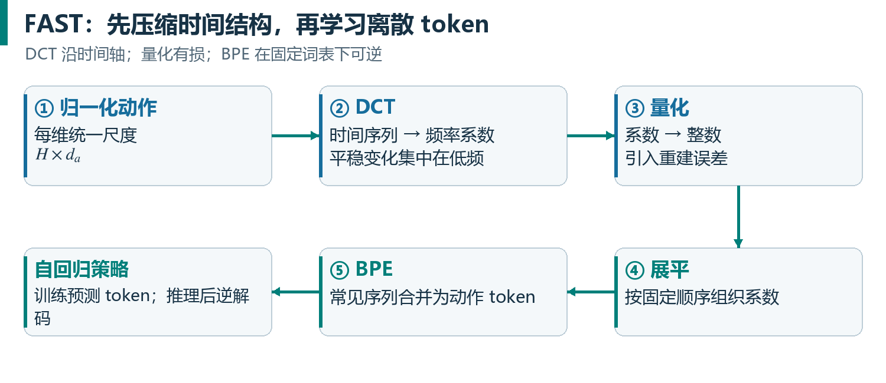

### 7.2 编码五步拆解

第一步，按约定归一化连续动作，让各维量纲适于压缩。第二步，对每个动作维度沿时间轴做离散余弦变换 DCT：平稳部分集中在低频，突变需要更高频系数。第三步，对系数量化成整数，这一步引入有损误差。第四步，按固定顺序展平系数，低频结构优先。第五步，用 BPE 合并常见整数子序列，输出较短 token 序列。

教学用 DCT 形式：

$$
c_k=\alpha_k\sum_{n=0}^{H-1}a_n\cos\!\left[\frac{\pi(n+1/2)k}{H}\right]
$$

$n$ 为控制时间索引，$k$ 为频率索引，$\alpha_k$ 取决于归一化约定。重点是“沿时间维变换”，不是对 14 个关节随便做一次压缩，也不是把运动轨迹当 JPEG 图片处理。

DCT 本身可逆；量化会损失信息；在固定词表下 BPE 对整数序列的编解码是可逆的。解码应依次执行 BPE 解码、恢复系数矩阵、反量化、逆 DCT、反归一化。省略动作空间 metadata，即使 token 能还原，也可能发错机器人命令。

### 7.3 为什么训练快，而推理未必快

训练时一次 teacher-forced 前向可以对全序列算交叉熵；压缩使 token 更有信息密度，也与 VLM 已熟悉的离散生成目标接近。推理时仍可能要生成几十个串行 token，然后才能还原一个完整 动作块。相较较小动作专家做少量并行 flow 步，大骨干的自回归解码可能更慢。

官方 FAST 结果给出训练约 5 倍提速、动作 token 通常约 30–60 个等实验现象；这不是适用于任意硬件、数据和 horizon 的常数。不能把 token 压缩率、训练 wall-clock 提速、推理延迟下降三者互换。[S3，§V-VI；官方研究页]

### 7.4 如何判断压缩是否过度

要画原动作与重建动作的每维时间曲线，检查位置误差、速度 / 加速度变化、夹爪切换时刻及接触阶段。整体 MSE 很小，仍可能把一个短促夹爪事件抹掉。压缩率应和任务成功率一起评估，而不是只统计 token 数。

自回归模型还存在训练时看到真实前文、推理时看到自己生成前文的差异。局部 token 错误可能影响后面的解码。FAST 改进动作表示，却不自动消除所有 exposure bias 或部署偏移。

## 08｜π0.5 与 Knowledge Insulation：同时保住语义和动作能力

### 8.1 π0.5 的核心问题是新环境

π0.5 关注的不是只在熟悉环境里把同一动作做得更漂亮，而是把视觉、语义、运动知识迁移到没有采集过训练数据的环境。数据混合包含机器人动作、高层子任务 / 语言监督以及非机器人视觉语言数据。不同数据承担不同约束：互联网数据丰富语义，机器人动作提供物理落地，高层标注连接任务理解与技能选择。[S4]

原论文采用两阶段路线：先在离散 token 统一表示下训练，包括 FAST 动作；再在后训练中加入连续动作专家，以满足动作质量与实时推理需求。后来的知识隔离研究把相关思想进一步整理为可单阶段联合训练的方案。把后续 KI 配方直接当成最初 π0.5 论文唯一配方，会掩盖这个演进。

### 8.2 高层与低层的概率分解

设总任务 $l$ 为“收拾桌面”，高层子任务 $\hat{l}$ 为“把红杯子放进水槽”。π0.5 用高层推断选择当前子任务，再用低层动作模型根据观测和子任务生成 $A$。

$$
p(A,\hat{l}\mid o,l)=p(\hat{l}\mid o,l)\,p(A\mid o,\hat{l})
$$

这个分解指出，原论文的低层动作分布通过 $\hat{l}$ 获得高层意图；同一模型可承担两种分布的建模，高层推断运行频率低于动作生成。它不是每 20 ms 生成一段长篇推理，也不必在每个控制步重写整个计划。[S4，§IV]

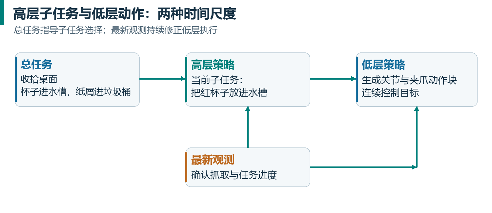

教学例：总任务是“把易碎杯子和纸屑收好”。高层决定先拿杯子、再处理纸屑，低层负责如何靠近、夹持、抬起和释放。若高层选错对象，低层可能精确执行错误意图；若低层抓取失败，高层若没有正确读取结果，后续计划也会错。因此分层需要进度感知，不能只在开始生成一次固定列表。

### 8.3 新动作头为什么会破坏原有知识

随机初始化的动作专家早期输出很差，产生的连续损失梯度也可能迫使骨干朝不利于原有语义能力的方向改变。只做机器人动作数据训练，模型还可能找到忽略语言的捷径：场景一出现就执行常见任务，而不是认真区分用户命令。

这不是说动作梯度必然有害，而是新模块、损失尺度、数据分布和预训练表征之间可能不协调。处理方式包括联合保留视觉语言任务、提供合适的机器人表征监督，以及限制新动作专家的梯度回流。[S5]

### 8.4 KI 的三条关键路径

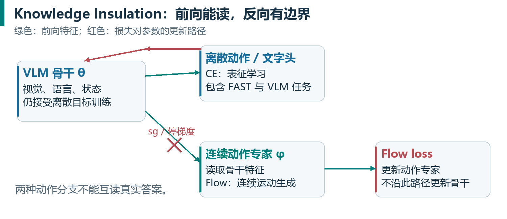

论文事实：KI 让骨干通过离散 FAST 动作和其他文字 / VLM 任务获得监督；连续动作专家读取骨干特征，用 flow loss 学习；动作专家到骨干的梯度通路被 stop-gradient 阻断。离散动作和连续动作分支不互相读取对方的答案。骨干仍可由自己的目标更新，所以这不等于冻结。[S5，§5]

用更清楚的计算图表达：$z=f_\theta(o,l)$，离散头给出 $\mathcal{L}_{\mathrm{CE}}(z)$，动作专家给出 $\mathcal{L}_{\mathrm{FM}}(g_\phi(\operatorname{sg}(z),X_\tau,\tau))$。由于 $\operatorname{sg}(z)$ 前向数值不变、反向导数为零，$\mathcal{L}_{\mathrm{FM}}$ 仍训练 $\phi$，但不通过该路径改变 $\theta$；$\mathcal{L}_{\mathrm{CE}}$ 仍训练 $\theta$。真实模型在多层 attention 的 $K$/$V$ 交互处实施隔离，这个公式只是把机制压缩成易读示意。

为什么不简单冻结骨干？因为原始 VLM 未必已经编码足够的机器人细节，需要动作相关表示学习；为什么不用单纯 flow loss？因为离散目标能对骨干提供更直接且适合预训练结构的学习信号；为什么同时保留两种动作表示？因为训练可利用离散信号的优势，部署可使用连续专家的效率。

### 8.5 防止答案泄漏

教学反例：训练时把真实 FAST 动作 token 放在前面，再让 flow 专家读取这些 token。专家可能不必理解图像就能还原答案；部署时没有真实 FAST token，能力就垮掉。KI 设计要求连续与离散动作输出在预测上独立，不能把辅助监督变成作弊输入。

这也是为什么不能只把两个 loss 相加就声称复现知识隔离。还必须检查 mask、前向依赖、detach / stop-gradient 的具体位置，以及每条损失实际更新哪些参数。

### 8.6 openpi 的 π0 与 π0.5 差异

核对的公开配置中，π0.5 将本体状态表示为离散文字 token 并置于前缀，动作专家使用 adaRMSNorm 注入 flow 时间；π0 则在动作专家路径处理中加入连续状态，并通过动作 / 时间融合 MLP 处理时间条件。adaRMSNorm 可以理解为“根据生成时间调整归一化后的特征”，不是改变机器人控制频率。

开放 checkpoint 的推理实现不一定包含论文中的所有联合训练分支、高层语义策略和数据混合；模型代码里有 `pi05=True`，不能据此认定完整 KI 训练体系已包含。本文以已核对版本的公开实现为准，具体文件导航见第 16 章。[S12]

## 09｜π0.6 与 π0.7：更大的骨干与更丰富的条件

### 9.1 π0.6 和 π*0.6 必须区分

论文事实：π0.6 延续 π0.5 / KI 思路，使用 Gemma 3 4B VLM，动作专家增至 860M，并扩充机器人训练数据。π*0.6 指经过 RECAP 强化学习流程改进的模型。改变基础架构和使用 RL 改进是两个维度，星号强调后者。[S8，§V]

因此，比较 π0.5 与 π*0.6 的表现，不能把全部提升归因于强化学习：骨干、数据和模型规模也变了。评估 RECAP 本身需要比较相同基础模型、相同任务与受控数据条件下的消融实验。

### 9.2 π0.7：把“怎么做”也放入上下文

π0.7 以 π0.6 架构和 MEM 为基础，扩展多模态上下文条件。公开论文给出约 5B 总规模：4B VLM 骨干和 860M 动作专家，视频历史编码承接 MEM。除任务和子任务外，还可输入描述数据质量、速度、错误情况的 episode metadata，以及目标图像等条件。[S11，§IV-VII]

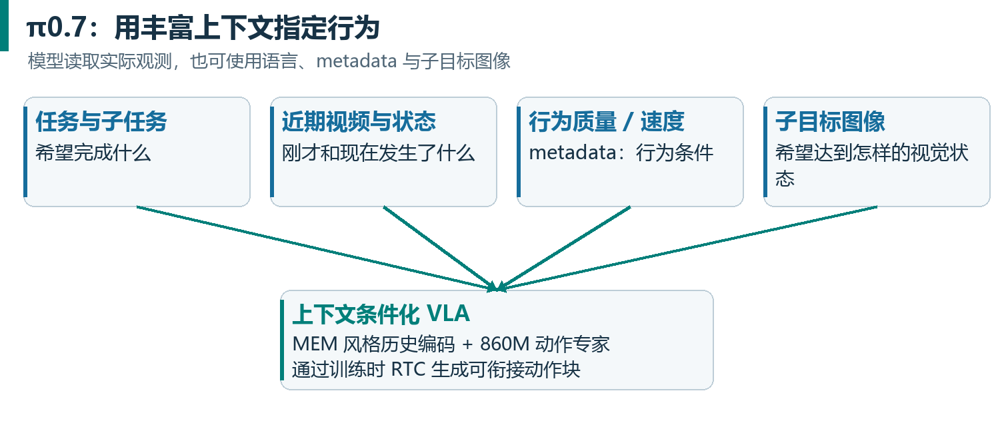

原理：如果训练数据混合了熟练、迟缓、失败和多种策略，而不告诉模型样本差异，目标分布可能互相冲突。把这些差异作为条件，模型可以学习“在什么条件下是哪种行为”。部署时给出希望的条件，有机会选择更高质量或更快的行为模式。但输入“高质量”不是一种逻辑保证，它必须有训练数据中的行为对应。

π0.7 还用来自 RL 专家策略的轨迹进行训练，使通用模型继承专用策略的技能。这里更接近通过条件化学习蒸馏行为，不能把使用 RL 产生的数据直接等同于该模型每一步都用在线 RL 更新。

### 9.3 目标图像与世界模型的分工

语言子任务表达“要做什么”，目标图像可以表达“完成后视觉上大致应是什么样”。论文系统可由基于 BAGEL 的图像生成世界模型产生子目标，再由 VLA 条件化执行。目标图像生成不需要与 50 Hz 电机命令同频，系统可异步刷新目标和动作。

教学例：语言“把衣服右边折向中间”仍存在空间歧义，目标图像有助于规定布料大致布局；然而生成图像可能包含不真实几何、遮挡错误或不可达形态。VLA 仍需根据当前观测控制，不应把目标图片视作已发生的真实观测。

这里使用未来训练帧作为“目标条件”是有定义的任务构造；若部署时由世界模型提供目标，则需要处理真实目标图像与生成图像的分布差异。它与在普通动作预测验证集里偷看未来观测不是一回事，评估必须保留正确的信息可用边界。

### 9.4 具体实现细节如何影响成本

论文描述每相机最多六帧历史、输入分辨率 $448\times448$，历史被压缩成单帧量级的输出 token；本体历史用线性投影表示，而非为每个状态标量生成大量文字。动作专家仍生成 50 步 动作块，采用训练时 RTC；其训练延迟范围为 0–12 控制步，对 50 Hz 相当于最多 240 ms。[S11，§VI]

“输出 token 数固定”不代表视频编码免费；“最多 240 ms”是训练覆盖范围，不是对任意网络抖动的硬保证；“新任务组合成功”也需要看任务选择和评测条件。用同一模型完成多种任务的证据，不等于完整解决通用机器人能力。

### 9.5 当前开放程度

本次核对的 openpi README 列出 π0、π0-FAST 和 π0.5 系列可用模型。官网在 2026-10-13 发布 Pi API beta，支持上传数据、托管微调与推理。API 可调用不等于可下载权重，也不等于公开了内部全量数据和训练流程；不要把截至 2025 年的“尚无 API”说法当作当前事实。[S12][S13]


## 10｜RTC：模型还在计算，机器人怎样继续动

### 10.1 三个时钟和一个缓冲区

机器人系统同时存在传感时钟、模型推理时钟和控制器时钟。相机不一定与关节控制同步；模型延迟可能从几十到几百毫秒变化；控制器仍需按固定周期消费动作。因此，生成动作必须带时间锚点，执行器需要知道某条命令对应的是哪一个未来时刻。

设控制周期 $\Delta t=1/f$，动作块长度 $H$，执行到新请求启动时已前进 $s$ 步，推理用 $d$ 个控制步。旧块剩余 $H-s$ 步，要覆盖新请求的等待时间，需 $d\leq H-s$。若旧块耗尽还没返回，新旧衔接算法再精巧也不能制造不存在的未来动作。

论文对离散延迟采用其定义的取整约定；工程保守排程常使用 把“端到端延迟除以控制周期”的结果向上取整，并加入抖动裕量。不能只用 GPU kernel 时间估计 $d$，还应计入图像采集、传输、排队、预处理与结果回传。[S6][S7]

### 10.2 具体时间轴：50 Hz、50 步、200 ms

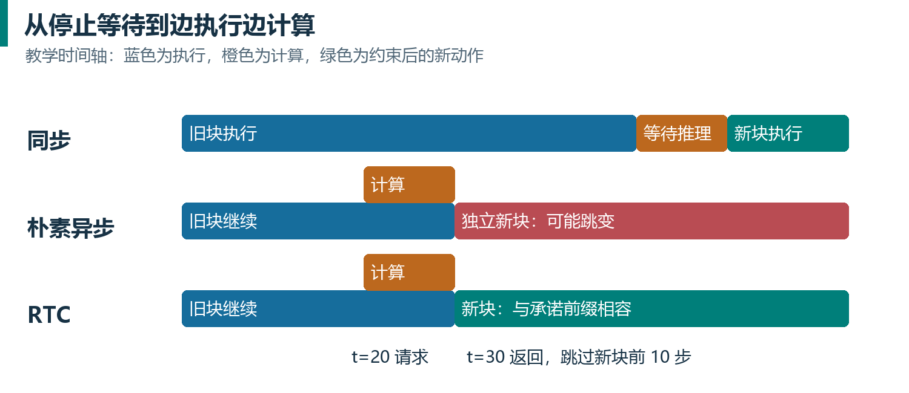

教学示例：旧 动作块 覆盖全局步 0–49；在步 20 开始新推理，因此 $s=20$。延迟 200 ms 在 50 Hz 下对应 $d=10$。新 动作块 以步 20 为锚点，覆盖全局步 20–69；到全局步 30 才返回。在等待中已经执行的步 20–29，必须来自旧 动作块。返回后应从新 动作块的局部索引 10 开始执行，绝不能从局部索引 0 重播。

两块共有 30 步重叠：全局 20–49。前 10 步已经被旧计划承诺执行；中间 20 步仍是旧计划的未来建议；最后全局 50–69 旧计划没有覆盖。RTC 对这三个区域采取不同约束强度，既保持连贯，又允许远期计划根据新观测调整。

### 10.3 为什么简单异步会跳变

同步方案是执行一块、停下来等模型、再执行下一块。它会引入训练示范中没有的停顿，降低速度。朴素异步则边执行边算，但新块是根据旧时刻观测独立生成的，可能选择完全不同策略。

教学例：旧块计划从障碍左边绕行，新块采样了右边绕行。直接切换可能要求突然跨过障碍；把两条路径平均，反而可能得到正中间撞障碍的路径。Temporal ensembling 有其适用场景，但不能保证对多峰策略的平均仍有效。[S6]

### 10.4 RTC 把衔接变成条件补全

把新动作块看作一段需要生成的序列：已经确定要执行的前缀是已知条件，后面部分需要补全。目标是从 由“新观测和已承诺动作前缀”共同限定的动作分布 采样，而非从 只由新观测限定的动作分布 独立采样后再剪接。

原始 inference-time RTC 使用基于 inpainting 的引导，不要求重训练现有 flow / diffusion 策略。采样过程中，先估计当前带噪动作将对应的干净动作，再计算它与旧块重叠区的偏差，用引导项修改生成轨迹。论文采用向量-Jacobian 乘积计算相应修正，并裁剪引导强度以提高少步采样的稳定性。[S6，§4]

教学用符号可帮助理解，但不替代论文算法：在本讲义 $\tau$ 约定下，干净动作估计约为 $\hat{A}=X_\tau+(1-\tau)v_\theta(X_\tau,\tau,o)$。定义连续性误差 $E=\frac{1}{2}\left\|W\odot(\hat{A}-A_{\mathrm{old,aligned}})\right\|^2$。沿着让 $E$ 下降的方向修正采样，就会鼓励新块尊重旧块的已承诺部分。原论文的引导系数与导数实现需要按其时间约定一起使用。

这里的求导是在推理时针对动作变量求导，不代表在线更新模型权重。RTC 的“梯度计算”与 RL 或训练的“优化器更新模型参数”不是同一件事。

### 10.5 soft mask 为什么重要

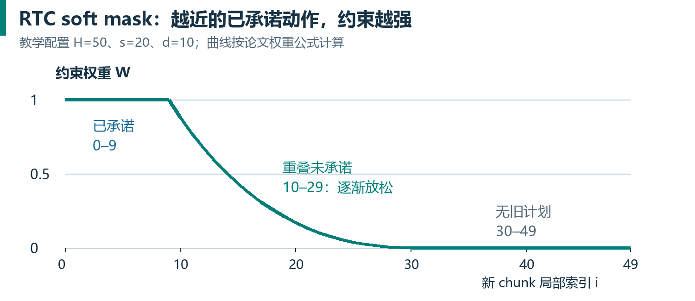

如果只固定最前面 $d$ 步，当 $d$ 很短时，后面仍可能很快切换到另一种策略。soft mask 对全部重叠动作提供从强到弱的约束：必执行前缀权重为 1，后续重叠区逐步衰减，旧块未覆盖的部分权重为 0。它把“未来越远越可以改”的思想写进生成过程。

原论文给出一类具体权重：对 $d\leq i<H-s$，令 $c_i=\frac{H-s-i}{H-s-d+1}$，$W_i=c_i\,\frac{\exp(c_i)-1}{e-1}$；$i<d$ 为 1，$i\geq H-s$ 为 0。图12使用 $H=50$、$s=20$、$d=10$ 的教学配置，按该公式绘制，不是论文性能数据。[S6，式5]

“前缀固定”首先是执行调度事实：那些动作已确定会被执行。引导采样对生成前缀的数值拟合可能是近似的，不能把引导机制解释成对所有实际关节动力学的严格连续性证明。

### 10.6 训练时 RTC：把补全能力提前学进去

Training-time RTC 在训练时采样延迟 $d$；前 $d$ 步输入真实、无噪动作，只有后缀加噪；允许不同动作 token 带不同 flow 时间；前缀不计算去噪损失。模型从训练阶段就学习“给定已承诺前缀，生成后续动作”。运行时输入旧块前缀，直接生成后缀，不再每个采样步都计算原始推理引导的额外向量-Jacobian 乘积。[S7，§IV]

```text
训练时：
  随机选 d；取真实 chunk A 和噪声 epsilon
  前缀位置 i < d：X[i] = A[i]，tau[i] = 1
  后缀位置 i >= d：X[i] = (1-tau)*epsilon[i] + tau*A[i]
  模型读取每个位置的 tau，预测向量场
  仅在后缀位置计算 flow loss

推理时：
  前缀填入旧 chunk 对齐后的已承诺动作
  后缀初始化噪声，迭代时只更新后缀
  依据实际时间戳丢弃已过去位置，再交给执行队列
```

以上使用 $\tau=1$ 表示干净动作的教学约定；若迁移到 openpi 的反向时间约定，前缀时间需相应变为 0。不要把同一段伪代码不加转换粘贴到不同实现。

原论文的真实机器人比较在目标任务上微调 8,000 梯度步、batch 512，训练延迟 0–10 步；在其 H100 远程推理、5 次去噪设置中，报告训练时 RTC 与推理时 RTC 平均端到端延迟约 108 ms 和 135 ms。该结论只适用于该实验，说明额外引导存在成本，不是“RTC 永远只有某个固定延迟”。[S7，§V-B]

### 10.7 实时部署需要的额外契约

推理请求应记录 observation timestamp、动作块 anchor、模型版本与使用的子任务 / 记忆版本。执行队列切换必须原子化，避免推理线程写一半时控制线程读到混合块。若请求过期、网络延迟超限、子任务被取消，需丢弃过时结果或进入既定的降级控制流程。

有新障碍突然进入、目标被移动或用户改变任务时，前缀约束与快速响应会发生冲突。RTC 提升衔接连贯性，但不是避障规划器、碰撞证明器或故障恢复系统。应在真实运行协议中规定何时可覆盖已排队动作，以及覆盖后如何重新规划。

## 11｜MEM：为什么机器人需要两种时间尺度的记忆

### 11.1 当前图像可能不足以决定动作

机器人看见一只杯子时，可能不知道它刚被洗过、是否已经加过糖、之前从哪边抓取失败。环境真实状态 $s_t$ 并不完全体现在当前观测 $o_t$ 中，这叫部分可观测性。策略需要历史 $h_t$，或者能概括历史的内部状态 / 记忆。

多给几帧图像能估计运动与遮挡，但记录十几分钟前的任务进度未必需要像素细节。MEM（Multi-Scale Embodied Memory）据此采用两条通路：短期用视频保留细节，长期用语言概括事件。[S9]

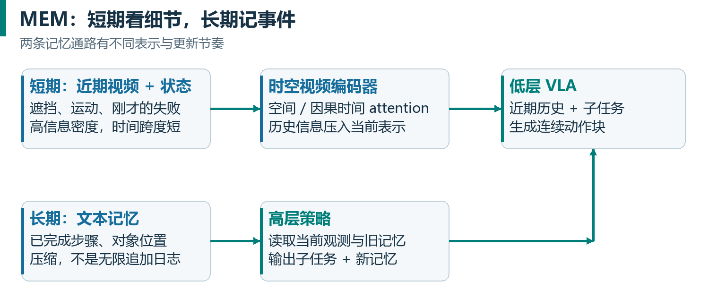

### 11.2 高层与低层如何协作

高层策略输入当前观测、总任务 $g$ 和旧记忆 $m_t$，输出新的子任务 $l_{t+1}$ 以及新记忆 $m_{t+1}$。低层策略读取短期观测窗口、子任务和任务目标生成连续动作。论文的分解近似为：

$$
p(A,l_{t+1},m_{t+1}\mid h_t,m_t,g)
$$

$$
\approx p_{\mathrm{LL}}(A\mid h_t^{\mathrm{short}},l_{t+1},g)\,p_{\mathrm{HL}}(l_{t+1},m_{t+1}\mid o_t,m_t,g)
$$

这里 $h_t$ 表示历史，$h_t^{\mathrm{short}}$ 表示近期观测窗口，$o_t$ 表示当前观测。

这强调长期语义记忆主要参与高层判断，再通过子任务影响低层执行；不能把图中两条通路简化为“把整份文字记忆和所有历史帧都塞进每一次动作生成”。高层更新记忆与低层高频动作生成有不同节奏。[S9，§III-A]

教学例：“已经把红杯子放进柜子；蓝盘子仍在水槽；柜门尚未关闭。”这里的重要信息是已完成事件、当前物体状态和待办事项。只记录“上次命令是关柜门”不够，因为命令可能执行失败。记忆需要与实际结果对齐。

### 11.3 短期视频编码如何省计算

假设每帧有 $P$ 个 patch、共 $K$ 帧。直接把 $KP$ 个 token 做全局注意力，注意力规模约 $\mathcal{O}(K^2P^2)$。分开做帧内空间注意力 $\mathcal{O}(KP^2)$ 和跨帧时间注意力 $\mathcal{O}(PK^2)$，可以减少交互成本，同时让当前帧特征吸收过去信息。

MEM 在 ViT 中交错使用空间和因果时间注意力，并在高层丢弃过去帧的显式 token，只把承载历史信息的当前帧表示送入后续 VLA。这不是在读取之前就把历史丢掉：先整合，再压缩。因果时间掩码避免用未来帧解释过去，从而保持运行时的信息边界。

论文还强调可以通过注意力模式与固定时间位置编码改造已有 ViT，而不需要为这部分新增一整套视频模型参数。输出给骨干的 token 数可保持单帧量级，但视觉编码器仍需处理历史；历史 $K$ 增大，计算和显存成本仍会上升。[S9，§III-C]

### 11.4 长期文本记忆如何获得训练标签

论文用带子任务和成功 / 失败标注的轨迹，借助现成 LLM 生成记忆更新监督。目标不是无限追加流水账，而是保留后续任务仍需要的信息，适时压缩或删除不重要细节。部署时由训练过的高层策略生成记忆更新，不能误解为每个控制周期都必须请求一个外部聊天 API。[S9，§III-B]

教学例：连续记了“放好红盘、放好蓝盘、放好白盘”，若后续不再区分颜色，可以压缩为“盘子已全部放好”；若指令稍后还要取回红盘，则颜色和存放位置就不应被删。记忆摘要是否合适取决于任务需求，不是越短越好。

在训练数据构建中，LLM 可以参考完整标注来制作监督，但模型的输入不能泄漏尚未发生的未来结果。尤其要区分“用于生成训练标签的离线信息”和“机器人运行时可访问的因果历史”。

### 11.5 具体实例化与上下文适应

π0.6-MEM 基于 Gemma 3 4B、860M 动作专家和 KI；论文预训练用六个观测、间隔约 1 秒，后训练扩展到更长历史，实验中可到 18 帧、约 54 秒的观测记忆配置。长期文本支持更长任务。不要把“任务持续 15 分钟”误解为始终把 15 分钟所有原始视频同时输入模型。[S9，§III-D]

模型失败一次后换抓法，是条件输入包含了“刚才这样做失败”的结果。权重可以保持不变，这叫 in-context adaptation；在线 RL 则通过奖励与数据更新参数。两者都能改善下一次动作，但机制不同，不能把看到新行为就断言模型现场训练了自己。

### 11.6 为什么有记忆有时反而更差

如果数据里过去动作几乎总能预测下一动作，模型可能依赖重复动作而忽略当前图像，形成因果混淆。另一个风险是记忆写错：把“尝试放入”记成“已经放入”，错误被长期保留并影响后续计划。摘要还可能丢失计数、先后次序或目标位置。

工程建议：设计专门的记忆测试，而不只观察长视频是否流畅。可以测试遮挡后找物体、重复尝试是否换策略、已完成事项是否重复、开过的柜门是否记得关、同样当前画面但不同过去是否产生不同正确动作。评测时对错误记忆、过期记忆和 episode 重置也应做干预。

重置尤其重要：新任务开始时若沿用上一个 episode 的文字或视频缓存，离线表现和线上行为都会混乱。KV cache、视频窗口、文本记忆和动作队列应有清晰生命周期，不能都用一个泛称“memory”掩盖。[S9]

## 12｜把 RTC 与 MEM 放在同一套系统里

MEM 增加历史信息，可能增加视觉编码或高层推断成本；RTC 利用旧计划覆盖新计划计算时间。二者处理不同瓶颈，因此可以联合使用。MEM 论文中就使用推理时或训练时 RTC 做真实机器人异步执行。[S9，§III-D]

教学系统分为四个循环：传感器持续采集；高层低频选择子任务并更新文字记忆；VLA 根据近期历史生成动作块；控制器高频消费动作。每个循环保存时间戳，并规定新子任务何时生效。动作块的条件版本不清楚，就可能出现“记忆已经说抓盘子，手上还在执行抓杯子的旧块”。

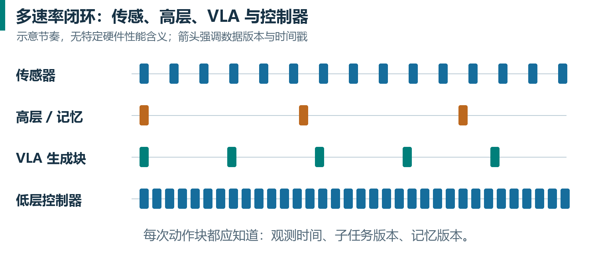

需要区分三个 horizon：动作预测 $H$ 是未来运动范围；短期观测 $K$ 是过去视觉范围；长期文本记忆覆盖的是语义事件范围。把 $K$ 从 6 增加到 18，并不意味着动作块 $H$ 也要从 50 增到 150。模型容量、计算时延和任务需求分别决定这些参数。

教学预算：若控制 50 Hz，计划执行 $s=20$ 步，理想重规划间隔为 400 ms；$H=50$ 让旧块在请求启动后还有 30 步余量。若新观测编码和生成需要 250 ms，约 13 步，余量尚够；若尾延迟达到 800 ms，约 40 步，就超过余量。平均延迟合格不能替代对 P95/P99 尾延迟与队列耗尽率的检查。

以上时间计算只说明调度可行性，不证明机器人动力学稳定。增加 history、提高分辨率或附加世界模型后，必须重新测完整流水线的真实延迟，而不是沿用单帧模型的性能表。


## 13｜强化学习前置：从“模仿动作”到“优化结果”

### 13.1 为什么示范学习会累积错误

BC 在示范状态上学习。部署时一次抓偏可能把机器人带到示范里少见的状态，之后更容易继续犯错，形成分布偏移。增加示范质量有帮助，但只学习完美轨迹未必覆盖恢复动作。由人接管纠正，可提供机器人自己实际遇到的困难状态上的正确动作。

“加入纠正”还不一定就是 RL：若只是把纠正动作作为监督标签再次训练，它属于交互式模仿学习。RL 则利用奖励与长期后果来判断哪些行为更有价值，允许在合适条件下超越示范中的速度或策略。

### 13.2 MDP、回报、价值、优势

MDP 用状态 $s$、动作 $a$、转移分布 $P$、奖励 $r$、折扣 $\gamma$ 表述序贯决策。机器人通常只能观察 $o$，存在部分可观测性；许多算法为了可操作性将观测或历史表示近似看作状态。MEM 有助于提供历史，但不能自动证明状态已经满足马尔可夫性。

$$
G_t=r_t+\gamma r_{t+1}+\gamma^2 r_{t+2}+\cdots
$$

$V^\pi(s)$：从状态 $s$ 按策略 $\pi$ 继续时的期望回报。

$Q^\pi(s,a)$：在 $s$ 先执行 $a$，再按 $\pi$ 继续时的期望回报。

$$
A^\pi(s,a)=Q^\pi(s,a)-V^\pi(s)
$$

优势衡量“这个动作比当前基准策略在该状态的平均表现好多少”，而不是只看动作的即时奖励。一次暂时后退可能有负即时进度，但能解除卡住并提高最终成功率，因此有正优势。$V$、$Q$、$A$ 的绝对数值依赖奖励尺度、折扣和时间单位。

### 13.3 四组术语

|区分|定义|常见误解|
|---|---|---|
|offline / online|是否继续通过交互收集新数据|用固定 replay 数据训练也可能是 RL|
|on-policy / off-policy|学习目标是否主要依赖当前策略的数据分布|online RL 不一定是 on-policy|
|actor / critic|actor 选动作，critic 评价回报|critic 不是人类，也未必生成文字评价|
|reward / loss|reward 定义希望的结果；loss 是优化计算形式|RL 也会使用 MSE 或交叉熵训练子模块|

经验回放 buffer 保存状态、实际动作、奖励、后继状态和终止信息。off-policy 方法可以重复使用旧策略、人类示范与干预数据。要保存真正执行的动作，不能只保存模型建议但被人类覆盖的动作，否则 critic 学到的转移关系会错。

### 13.4 为什么“直接给 flow VLA 套 PPO”并不简单

PPO 通常需要动作对数概率和新旧策略概率比。自回归离散动作可按 token 分解概率；flow 模型的采样由多步 ODE 过程产生，其动作边缘密度通常不能像离散 softmax 那样直接获得。存在专门的扩散 / flow RL 方法，但必须明确概率、采样轨迹和梯度估计方式。

因此 RECAP 选择用价值估计产生优势条件，再用兼容原模型的监督式生成目标提取更好策略；RLT 则冻结大 VLA，把 RL 放在更小且便于优化的 actor-critic 上。两者都利用 RL 信号，但优化路线很不相同。[S8][S10]

## 14｜RECAP 与 π*0.6：从自主经验和人类纠正中学习

### 14.1 三步循环

RECAP 全称为 RL with Experience & Corrections via Advantage-conditioned Policies。它循环执行：收集经验和可选纠正；用累计数据训练价值函数；依据价值估计生成优势标签并训练条件策略。π*0.6 是把该流程应用于 π0.6 后得到的模型。[S8]

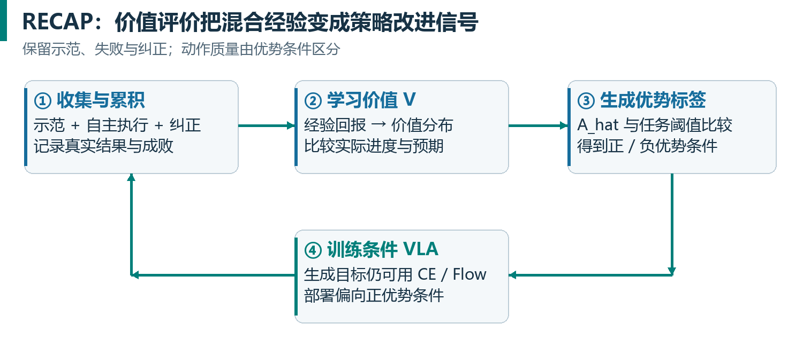

先从示范获得可用策略，部署后记录成功和失败；困难状态可以由人接管，补充纠正。累积数据包含“好动作、坏动作、恢复动作和不同历史版本策略”。这比只收集成功轨迹更丰富，但也需要机制避免把低质量行为无差别模仿。

### 14.2 奖励如何同时表示成功和速度

论文使用以 episode 成败为基础的通用奖励构造：普通步骤为 −1，成功终止为 0，失败终止为较大负惩罚 $-C_{\mathrm{fail}}$。成功越快，累计负回报越少；失败额外扣分。价值再按任务长度尺度归一化到近似 $(-1,0)$，便于多任务训练。[S8，§V-C]

教学例：同样成功，路径甲还需 40 步、路径乙还需 80 步，若其余条件一致，甲的回报更高。若过度缩小失败惩罚，策略可能偏好快速结束但失败；若只给最终成功奖励且不折扣、不惩罚时间，快慢可能无法区分。奖励设计写出了“想要什么”，不是一个无关紧要的实现细节。

这种稀疏人工标签不要求人逐帧给精细奖励，但价值学习仍依赖标签可靠性、任务长度约定和失败定义。把尚未完成的截断 episode 当作真正终止失败，可能扭曲价值目标，应按具体协议处理。

### 14.3 分布式价值函数是什么

RECAP 不是直接回归一个确定标量，而是预测离散价值区间上的分布。论文用 201 个 bins，将从轨迹算出的经验回报离散化，用交叉熵训练；再通过概率加权均值取得连续 $V$。输入包括观测和语言任务。这样有助于表示不同结果下的回报分布。[S8，§IV-A]

这里“distributional value”是回报分布，不是分布式 GPU 训练；201 是价值类别数，也不是 batch size。critic 的训练目标可以是 CE，而整个系统仍属于强化学习。

### 14.4 用未来一小段结果估计优势

一个通用 $n$-step 估计为：

$$
\hat{A}_t=\sum_{j=0}^{n-1}\gamma^j r_{t+j}+\gamma^n V(o_{t+n})-V(o_t)
$$

它比较“实际走了这 $n$ 步、之后预计得到什么”与“从原状态本来预计得到什么”。RECAP 的具体奖励设定采用相应非折扣表达，并在后训练中使用固定 lookahead 的价值差形式。[S8，附录F]

教学例：未归一化时 $V(o_t)=-50$，接下来 5 步奖励合计 −5，$V(o_{t+5})=-30$，则优势约为 $-5-30-(-50)=15$。意思是这段行为比原来预计更有效地接近成功。若 $V$ 的估计错误，优势标签也会错，因此 critic 质量直接影响策略改进。

这说明“失败 episode 中所有动作都坏”是错误的。失败轨迹可能包含正确接近和良好恢复；成功轨迹也可能包含无谓绕路。优势条件试图把局部行为质量与整个 episode 的最终成败进一步区分。

### 14.5 条件化学习，而不是把负样本全部扔掉

设 $I_t=\mathbf{1}[\hat{A}_t>\varepsilon_l]$，$\varepsilon_l$ 是任务相关阈值。将正 / 负优势标签作为动作生成条件。训练时不同质量数据都可以保留，但模型知道它们对应的条件；部署时要求正优势条件，从学到的较好行为子分布采样。

直觉上的目标可写为在数据上学习 $p_\theta(A\mid o,l,I)$，并通过条件 dropout 同时学到 $p_\theta(A\mid o,l)$。连续动作仍采用 flow loss；离散输出采用 CE。监督式 loss 并没有取消 RL 属性：条件标签来自奖励、价值和经验驱动的策略改进循环，而非人工凭空写一个“优秀”标签。

论文把优势指示放在子任务输出之后、动作之前，因此它直接影响动作分布。人类纠正动作可被强制标为正优势，这是依赖专家纠正质量的设计假设，不是数学上保证所有人类接管都最优。[S8，§IV-B、V-B]

### 14.6 CFG 与引导强度

训练时偶尔丢掉优势条件，让模型同时支持有条件 / 无条件分布，可以在推理时进行 classifier-free guidance。通俗讲，是增强“高优势条件相对一般行为”的偏好。它与 RTC 的连续性引导都可能被称为 guidance，但条件和目的不同：一个偏好高价值行为，一个保持已承诺动作的连贯。

引导太强可能把动作推向训练支持范围的边缘，变得激进或不稳定。阈值、条件丢弃概率和引导强度需共同验证，不应假设数字越大、策略越好。本文不把论文某一任务的设定推荐为通用生产参数。

### 14.7 RECAP 的收益如何评估

要同时看成功率、成功完成耗时、每小时成功次数、人工介入次数和异常情况。若把平均时长只算在成功样本上，容易忽略大量失败所花时间。吞吐最好直接用所有测试时间内的成功数计，包括明确定义的失败与重置开销。

官方报告在若干困难任务上吞吐翻倍以上、失败率显著下降；这不是所有任务的普适倍数。结论应限定在其任务、机器人、数据与实验协议中。复现实验需记录总交互量、纠正比例、critic 数据、策略更新次数，以及是否使用相同基础 checkpoint。[S8]

## 15｜RLT：冻结大 VLA，快速在线改进精密动作

### 15.1 为什么另做一条 RL 路线

若只想改善插头对准接口的最后一段运动，每次都更新几十亿参数代价很高。RLT（RL Token）先从 VLA 内部提取小型状态表示，再训练轻量 actor-critic，利用 VLA 的感知与行为先验。它针对精细关键阶段的快速适应，与 RECAP 面向较广泛任务经验的迭代训练互补。[S10]

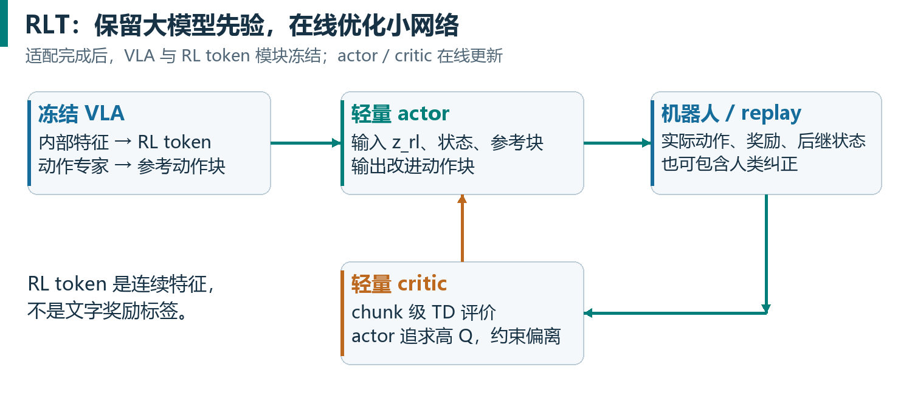

### 15.2 RL token 是一个学习出的连续表示

先取得 VLA 最后一层的 token 特征 $z_1,\ldots,z_M$，追加可学习的 <rl> 读出向量，经小型 encoder Transformer 得到 $z_{\mathrm{rl}}$。decoder 根据 $z_{\mathrm{rl}}$ 以及已提供的前序特征重建原始特征，使用平方重建损失。重建目标 stop-gradient，防止压缩任务把目标本身改坏；可另外结合 VLA 的任务监督微调。[S10，§IV-A]

完成适配后冻结 VLA 和 RL token 模块，在线更新轻量 actor / critic。$z_{\mathrm{rl}}$ 是连续特征向量，不是人能读的文字 token，也不是一个离散动作编号。重建任务鼓励压缩表示保留信息，但并不证明它已经是所有任务的完美充分统计量。

### 15.3 参考动作比只有视觉特征更有用

冻结 VLA 同时给出一个参考动作块 $A_{\mathrm{ref}}$。actor 输入状态表示 $x=(z_{\mathrm{rl}},q)$ 和 $A_{\mathrm{ref}}$，输出动作块分布。它有机会保留大模型已选好的多峰模式，例如“从左边插入”，再调整局部位置和速度，而不必从一个小向量重新发明完整策略。

RLT 的 actor 直接条件化参考动作并输出动作分布，不应简单等同于固定公式 $A=A_{\mathrm{ref}}+\Delta A$ 的残差控制器。它在目标中加入靠近 $A_{\mathrm{ref}}$ 的惩罚，形成局部动作修正的偏好，而不是强制采用某种固定加法结构。[S10，§IV-B]

### 15.4 动作块级 critic 的 TD 目标

设 RL 每次真正决策 / 执行的块长为 $C$，可能小于 VLA 的预测 $H$。critic 输入 $x$ 和 $C$ 步动作块，目标为该块内折扣奖励和，加上 $\gamma^C$ 乘后继状态价值。终止时 bootstrap 项应被相应 mask 去掉。

$$
y=\sum_{j=0}^{C-1}\gamma^j r_{t+j}+(1-\mathrm{done})\gamma^C Q_{\mathrm{target}}(x_{\mathrm{next}},A_{\mathrm{next}})
$$

$$
\mathcal{L}_Q=\mathbb{E}\!\left[(Q_\psi(x,A)-y)^2\right]
$$

$$
\mathcal{L}_{\mathrm{actor}}=\mathbb{E}\!\left[-Q_\psi(x,A)+\beta\left\|A-A_{\mathrm{ref}}\right\|^2\right]
$$

第一项让 actor 争取高价值，第二项约束偏离 VLA 的幅度。$\beta$ 太大可能只复制参考动作，太小可能让探索离开可靠区域。这是适用于讲解的主要形式，完整实现还包含目标网络、更新调度等细节。[S10，式3-5]

时间单位十分重要：如果 $\gamma$ 是每个底层控制步折扣，跨 $C$ 步应使用 $\gamma^C$；若直接把 $\gamma$ 当 动作块级折扣，需明确这是另一套时间尺度。执行频率变了而奖励和折扣不变，等于悄悄改变优化偏好。

### 15.5 为什么需要 reference-action dropout

早期 critic 不准，actor 最容易学到“照抄参考动作”。RLT 在一部分训练样本中把 actor 输入的参考块替换成零，迫使它保留独立动作生成通路。等 critic 学到有用信号后，actor 可以在合适情况下偏离参考。这不是把真实执行动作随机置零，也不是关闭控制器。

经验回放包含 VLA 热身数据、在线策略轨迹和可选人类纠正。论文在干预时保存实际人类动作，并将相应参考动作也替换为纠正动作，使策略锚定到这段可靠纠正，而不是继续被旧错误建议拉回。[S10，算法1]

### 15.6 更新数据比 UTD 和重置时间

UTD（update-to-data ratio）说明每采集一定量新数据，进行多少次优化更新。它不同于 batch，也不同于 epoch。离线 / 在线混合、按控制步或按 动作块 计数，都可能改变其定义，报告时必须写明。

小网络可以从 replay 反复更新，提升有限真实交互的数据利用率；但同一批数据反复学习也会造成过拟合与 critic 错误放大。网络小并不自动保证稳定。应监控 $Q$ 值尺度、动作偏移、成功率和新旧数据组成。

官网的 Ethernet 示例区分“约 15 分钟有效机器人数据”与“约 2 小时总训练流程”，后者包含重置等开销。评估在线学习效率至少同时报告有效交互时间、墙钟时间、重置次数、人工参与和计算资源，不能只挑最短的一个数字。[S10，官方研究页]

### 15.7 谁决定何时把控制交给 RLT

论文把改进集中在任务关键阶段：普通阶段由基础 VLA 完成，收集时可由人选择何时切换到 RL 策略；随后可用这些切换标签训练自动交接预测。不能把关键阶段的短程提升直接外推成整套长任务都由 RL 无人参与学习完成。[S10，§V]

在工程系统里，还需定义进入 / 退出关键阶段条件、失败回退、状态缓存更新和动作队列所有权。如果 actor 修改了动作，RTC 下次的已承诺前缀必须来自最终排队执行的动作，不能仍引用未修改的基础 VLA 建议。RLT 与 RTC 可以设计为互补，但接口不对齐会破坏连续性。

### 15.8 三种改进机制的对照

|机制|用什么新信息|是否改变权重|最直接解决的问题|
|---|---|---|---|
|MEM 的上下文适应|本 episode 的观测和事件记忆|推理期间可保持不变|刚才失败过，应改变下一次尝试|
|RECAP|多次执行的回报、价值、纠正|迭代训练 VLA 与价值函数|从积累经验中提升可靠性与吞吐|
|RLT|在线 replay 与奖励，VLA 参考动作|主要更新小 actor / critic|快速优化某个精密关键阶段|

如果任务失败因为“看不见刚才的位置”，优先检查记忆；如果因为“计算结果来晚了”，优先检查实时调度；如果状态已知、调度正常，但动作长期次优，才更有理由引入策略改进。分清瓶颈能避免用最复杂的算法处理基础数据错误。


## 16｜把论文知识映射到 openpi 实现

### 16.1 固定版本，再讨论“默认参数”

本讲义核对的 openpi commit 为 215abfb217dbac7d5f1273282331b9b1866c0479（2026-08-24）。读取日期为 2026-10-24 至 25。源码来自官方仓库，本文保存读取文件的 SHA-256 清单用于追溯。未来主分支可能变化，因此以下参数是这个快照的结果，不是永远不变的产品规格。[S12]

|位置|阅读目标|需要避免的误解|
|---|---|---|
|`README.md`|模型清单、支持范围、环境与微调示例|论文全部能力不等于仓库全部实现|
|`src/openpi/models/pi0_config.py`|action_dim、action_horizon、pi05 开关|32 维默认容量不等于真实机械臂维度|
|`src/openpi/models/pi0.py`|prefix / suffix、compute_loss、sample_actions|flow 的 $t$ 与论文 $\tau$ 方向不同|
|`src/openpi/training/config.py`|数据变换、checkpoint、训练配置|类默认值可能被具体 recipe 覆盖|
|`src/openpi/transforms.py`|归一化、增量 动作、token 化等|输入处理与输出逆变换必须成对|
|`scripts/train.py`|实际 batch、优化器更新与日志|分片设备数不直接等于数据副本数|

### 16.2 已核对的几个参数

|字段 / 行为|快照中的值或说明|实际含义|
|---|---|---|
|`Pi0Config.action_dim`|32|模型动作向量容量，可含填充|
|`Pi0Config.action_horizon`|50|每次预测 50 个动作时间位置|
|`max_token_len`|π0 为 48，π0.5 为 200|对应文本等 tokenizer 的长度设定，不是全部视觉 token 上限|
|dtype|bfloat16|模型配置中的计算类型，不表示所有状态都占 2 字节|
|`sample_actions.num_steps`|默认 10|一次动作块生成的积分次数|
|`TrainConfig.batch_size`|默认 32，标注为 global|需确认具体训练配置和后端是否覆盖|
|`num_train_steps`|默认 30,000|优化更新预算，不能当成 30,000 个 episode|
|`ema_decay`|默认 0.99|参数移动平均，可被 recipe 改动或禁用|

README 明确说明，这个版本对 π0.5 的训练与推理支持 flow matching head。不要把持有该 checkpoint 等同于获得论文中全部高层子任务生成、FAST 联合训练和非机器人数据混合管线。不同 JAX / PyTorch 后端支持程度也可能不同，必须分别看对应脚本，不能仅凭相同配置字段推断功能一致。[S12]

### 16.3 设备预算怎样估算

显存至少分成权重、梯度、优化器状态、激活、临时工作区和缓存。以 3.3B 模型作教学估算：若所有权重仅按 2 字节存储，约 6.6 GB（十进制），但训练显然不止这些；还要梯度、动量 / 方差、可能的主权重和多模态激活。LoRA 可以减少优化器状态，但视觉 token 与长历史激活仍可能占很大空间。

官方快照的单卡估计是推理 >8 GB、LoRA 微调 >22.5 GB、全量微调 >70 GB，并说明其测试环境是 Ubuntu 22.04。这是该项目给出的配置估计，不能作为所有 batch、相机、精度和实现下的保证。当前 Windows 电脑可用于阅读、数据准备或远程开发；本文未在用户电脑上安装训练环境或启动机器人训练。[S12]

## 17｜微调与验证的可执行路线

### 17.1 第一步：定义任务和成功标准

教学项目：让双臂机器人把两类物体分别放入指定容器。首先定义输入相机、关节与夹爪状态、动作空间、控制频率、超时时间、成功 / 失败标准。再决定是要同场景成功、未见物体成功还是新场景成功。任务定义决定数据划分与评测，不应训练完成后才挑一种最好看的口径。

保留失败原因标签：识别错对象、语言理解错、接近失败、夹持失败、释放失败、队列停顿、长程漏步骤。它们对应不同改进方向。一个总成功率不足以告诉你应该增加数据、改归一化、引入 MEM 还是 RTC。

### 17.2 第二步：验证数据与接口

先可视化几个完整 episode，同时画关节状态、目标动作、夹爪通道与时间轴。完成一次归一化再反归一化的往返检查；完成动作输入变换到输出逆变换的往返检查；检查 episode 尾部是否跨越下一 episode 取未来动作；确保缺失相机与填充位置处理正确。

再取极小、确定的数据子集验证训练管线是否能拟合，目的在于排查接线问题，而非证明泛化。若连小数据都拟合不了，应先检查标签方向、mask、时间错位、动作单位和冻结参数范围。只增加训练步数可能掩盖根本错误。

### 17.3 第三步：建立最简单有效基线

先用可核对的公开 checkpoint 和原始推理方式建立基线，保存完整配置与闭环日志。微调时一次只调整少数因素，分别比较全量与 LoRA、不同数据覆盖、不同学习率或更新预算。改变 batch 时同时记录样本呈现次数和 wall-clock，避免只按 step 对比。

教学试验表：

|试验|保持一致的条件|唯一主要变化|要回答的问题|
|---|---|---|---|
|$A$|任务、评测集、控制定义|基础 checkpoint 直接运行|迁移起点如何？|
|$B$|同上|加入目标任务示范微调|领域适应是否有效？|
|$C$|$B$ 的数据与预算|LoRA / 全量更新方式|资源节省的质量代价是什么？|
|$D$|同一模型与评测|RTC 开 / 关|瓶颈是否来自延迟？|
|$E$|相同数据覆盖|历史记忆建模|任务是否确实依赖过去？|
|$F$|相同起点|经验 / 纠正 / RL 改进|收益是否超过额外交互成本？|

这里 $E$、$F$ 是研究设计，不意味着公开 openpi 中已有一键 MEM / RECAP。若缺少对应组件，应先实现并验证接口，不要把一个模块名称当成可直接打开的参数。

### 17.4 第四步：度量真实闭环

至少报告：任务成功次数 / 总次数、场景与对象范围、最大时限、成功与失败耗时、总墙钟吞吐、人工介入、模型延迟分布和队列耗尽。不同初始状态应按预先制定的规则抽样，测试时不要只挑训练过的摆放。

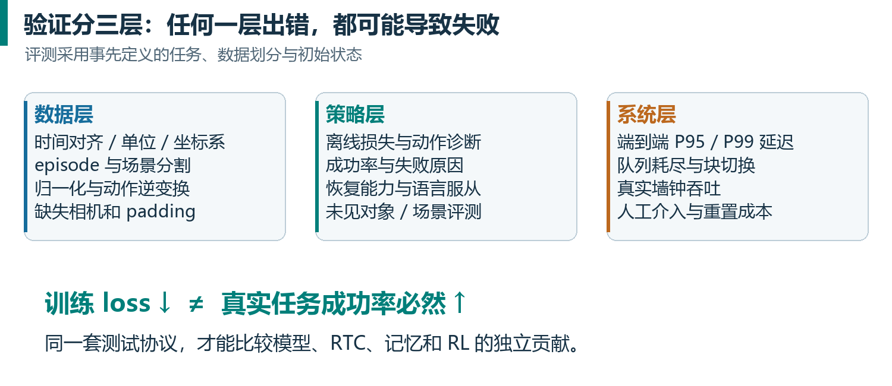

教学统计例：20 次试验成功 16 次，点估计是 80%，但样本很少，不能把它讲成精确到个位数的真实成功率。模型 $B$ 成功 17 次也不足以直接证明比 $A$ 显著更好。需要更多试验、相同条件的配对比较或适当置信区间，并明确失败与超时计入规则。

吞吐也可能与成功率相冲突。教学例：策略 $A$ 每次平均 20 秒、成功率 80%；策略 $B$ 每次平均 10 秒、成功率 70%。忽略重置的近似成功吞吐分别为 2.4 和 4.2 次 / 分钟；若 $B$ 的失败需要长时间人工重置，实际优势可能消失。真正应报告全程测得的成功数 / 总时间。

### 17.5 常见故障排查

|现象|优先检查|不要先做什么|
|---|---|---|
|loss 低，机器人方向相反|动作坐标系、单位、增量 逆变换|盲目加模型规模|
|每个 动作块 边界停顿|同步调用、队列、端到端延迟|只加训练 epoch|
|切块抽动|时间对齐、旧前缀、模式切换|直接假定平均动作一定安全|
|完全不听语言|任务与场景捷径、指令多样性、遗忘|只扩大图像分辨率|
|验证好，换房间失败|场景泄漏、相机视角、数据覆盖|只报告随机帧划分结果|
|重复同一种失败|历史条件、失败恢复数据、状态覆盖|把所有问题都归因于采样随机性|
|RL 越训越激进|奖励尺度、critic 偏差、参考正则、数据支持|仅继续提高学习率|
|接上 MEM 后超时|视频编码成本、缓存、$K$、调度|把固定输出 token 当零额外成本|

## 18｜贯穿案例：整理厨房时，各方法分别在做什么

总指令：“把杯子放进柜子，擦干台面，最后关闭所有柜门。”初始视觉包含杯子、湿台面和柜子，关节状态告知机械臂位置。VLM 表征提供对象与语义关系，高层策略选择“拿起杯子”，动作专家生成连续动作块。

控制器以 50 Hz 跟踪动作目标；推理服务在旧块执行期间计算下一块。RTC 使新块与实际已排队动作兼容。若杯子被另一只手遮挡，短期视频历史有助于保持杯子位置与运动线索；长期文本记忆记录“杯子已放入，柜门还开着”。

夹取失败后，短期历史让同一模型看到刚才的失败，可能改变接近姿态；这一步不必更新权重。若经过多次部署，发现“从这个角度抓”长期失败，则收集失败和纠正，使用微调或 RECAP 改变未来策略。若瓶颈只在关门锁扣的精密对准阶段，可以研究 RLT 局部优化，而不必从头训练整个通用模型。

π0.7 式的目标图像可进一步给出希望的台面或柜子状态，metadata 可指定期望行为风格。但最终是否真正放好了杯子、擦干了台面、关上柜门，仍需要真实观测与任务评测确认。计划文本或生成图片不能代替物理结果。

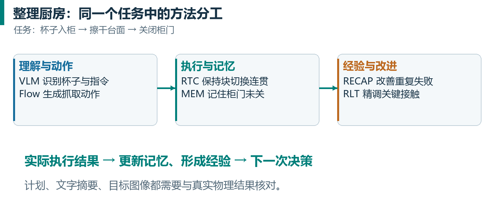

这个案例也展示兼容性边界：MEM 记忆应根据实际执行更新；RLT 修改动作后，RTC 应读取修改后的承诺前缀；高层切换子任务时，要决定旧 动作块 继续多久；RL replay 应记录真实动作与对应观测版本。把每个模块独立跑通，只是系统整合的开始。

## 19｜检查理解：十五问与答案

### 问题

1. $B=16$、$H=50$ 是否意味着 批量为 800？
2. 梯度累计 8 次是否等于把一个动作块执行 8 次？
3. 50 Hz 控制是否要求完整大模型推理每次少于 20 ms？
4. Transformer 的所有 token 都是离散 ID 吗？
5. flow matching 的 velocity 一定是关节物理速度吗？
6. 为什么论文目标 $A-\varepsilon$ 和 openpi 目标 $\varepsilon-A$ 都可能正确？
7. FAST 训练快，为什么推理可能慢？
8. stop-gradient 是否等于冻结整个 VLM？
9. π0.5 的公开 flow checkpoint 是否自动包含全部论文体系？
10. RTC 为什么不能简单用两块动作平均代替？
11. MEM 的 15 分钟任务是否意味 VLM 同时读入 15 分钟原始视频？
12. 失败一次后换策略，是否证明模型进行了在线 RL？
13. RECAP 为什么保留负优势数据？
14. RLT 的 RL token 是否就是一个奖励 token？
15. 为什么 online RL 的 15 分钟数据不等于 15 分钟完成训练？

### 答案与解释

1. 不是。$B=16$ 个观测锚点样本，每个标签含 50 个相关未来动作。800 是动作时间位置数。
2. 不是。前者发生在参数优化循环，后者是环境执行；它们的时间尺度与变量完全不同。
3. 不一定。可以低频预测动作块，由控制器高频消费；但必须有实时调度与足够队列余量。
4. 不是。图像 patch、连续状态和连续动作可以用向量 token；离散文字和 FAST token 只是其中一类。
5. 不一定。它是生成时间中的动作样本变化率；要看动作本身定义才能判断物理单位。
6. 两者采用相反的生成时间方向。插值、速度符号和积分方向一起转换才一致。
7. teacher-forced 训练并行、信息密度高；推理仍有串行 token 解码和大骨干成本。
8. 不是。KI 只阻断动作专家到骨干的特定梯度，骨干仍可由离散动作与 VLM 目标训练。
9. 不是。公开实现、训练数据、辅助目标、高层策略和完整研究系统的可用范围不同。
10. 多峰有效策略的平均可能无效，且不能保证时间对齐。RTC 在生成时引入已承诺动作条件。
11. 不是。短期观测保持细节，长期文本压缩事件；最终骨干 token 数也经过控制。
12. 不是。MEM 的上下文适应可以在权重不变时发生；在线 RL 涉及经验驱动参数更新。
13. 用条件区分行为质量，同时保留状态覆盖和对低质量行为的建模；部署偏向正优势条件。
14. 不是。它是从 VLA 内部表示中学习到的连续状态特征，供小 actor-critic 使用。
15. 因为重置、准备、人工干预、计算、通信与评估都消耗墙钟时间。

## 20｜符号、术语与公式速查

|符号 / 术语|本讲义含义|容易混淆的对象|
|---|---|---|
|$t$|真实机器人控制时间索引|flow 生成时间|
|$\tau$|噪声到动作的生成时间，0→1|openpi 反向时间 $t$，1→0|
|$B$|训练样本 batch 数|机器人自由度、动作块长度|
|$K$|短期历史帧数|attention 的 Key 矩阵，需看上下文|
|$H$|VLA 预测动作步数|实际执行步数 $s$|
|$d_a$|每步动作维数|RTC 延迟步数 $d$|
|$d$|RTC 推理延迟，以控制步计|动作 embedding 宽度|
|$s$|执行 / 重规划间隔所用 horizon|MDP 状态 $s$，需看章节|
|$C$|RLT 实际动作块步数|前文相机数量 $C$，需看章节|
|$\theta$、$\phi$、$\psi$|策略、辅助模块、价值模型等参数|固定数学常数|
|$V$、$Q$、$A$|状态价值、动作价值、优势|动作块 $A$，需看章节|
|BC|Behavioral Cloning，行为克隆|所有形式的强化学习|
|VLM / VLA|视觉语言 / 视觉语言动作模型|普通文本模型|
|KI|Knowledge Insulation，知识隔离|全骨干冻结|
|RTC|Real-Time Chunking，实时分块执行|缩短所有前向计算的加速器|
|MEM|Multi-Scale Embodied Memory|KV cache 或参数记忆的同义词|
|RECAP|经验与纠正驱动的优势条件策略学习|单纯成功轨迹筛选或通用 PPO|
|RLT|RL Token 路线|给奖励数值加个文字 token|

关键公式汇总：有效批量 $B_{\mathrm{eff}}=b\times D\times G$；固定集合每轮更新约 $N/B_{\mathrm{eff}}$；动作覆盖时间 $H/f$；RTC 等待覆盖条件 $d\leq H-s$；flow 路径 $X_\tau=(1-\tau)\varepsilon+\tau A$；flow 目标 $A-\varepsilon$；优势 $A^\pi=Q^\pi-V^\pi$；动作块 TD bootstrap 使用 $\gamma^C$。所有公式都依赖正文说明的计数与时间约定。

## 21｜原始资料、阅读顺序与证据边界

建议先读 π0 的架构与 flow 部分，再读 FAST、π0.5、KI；随后读 RTC 和训练时 RTC；最后按 MEM、π*0.6、RLT、π0.7 的顺序理解系统整合。论文的附录往往比摘要更能回答“具体怎么训练”。

[S1] Physical Intelligence，π0: $A$ Vision-Language-Action Flow Model for General Robot Control。重点：§IV、§$V$、附录$B$-$D$。[论文 PDF](https://www.pi.website/download/pi0.pdf)；[官方介绍](https://www.pi.website/blog/pi0)。

[S2] Kim 等，OpenVLA: An Open-Source Vision-Language-Action Model，2024。用于对照离散动作 VLA 与预训练迁移。[论文](https://arxiv.org/abs/2406.09246)。

[S3] Pertsch 等，FAST: Efficient Action Tokenization for Vision-Language-Action Models，2025。重点：DCT、量化、BPE、训练与推理权衡。[论文全文](https://arxiv.org/html/2501.09747v1)；[官方介绍](https://www.pi.website/research/fast)。

[S4] Physical Intelligence，π0.5: $a$ Vision-Language-Action Model with Open-World Generalization，2025。重点：§IV 的数据混合、两阶段与高低层分解。[论文 PDF](https://www.pi.website/download/pi05.pdf)；[官方介绍](https://www.pi.website/blog/pi05)。

[S5] Driess 等，Knowledge Insulating Vision-Language-Action Models: Train Fast, Run Fast, Generalize Better，2025。重点：§5 的分支、mask 与 stop-gradient。[论文 PDF](https://www.pi.website/download/pi05_KI.pdf)；[官方介绍](https://www.pi.website/research/knowledge_insulation)。

[S6] Black、Galliker、Levine，Real-Time Execution of Action Chunking Flow Policies，2025。重点：§3-4、式5、算法1。[论文全文](https://arxiv.org/html/2506.07339v1)；[官方介绍](https://www.pi.website/research/real_time_chunking)。

[S7] Black 等，Training-Time Action Conditioning for Efficient Real-Time Chunking，2025。重点：§IV、§$V$-$B$。本文伪代码使用自洽的噪声→动作时间约定，复现请核对原算法符号。[论文全文](https://arxiv.org/html/2512.05964v1)。

[S8] Physical Intelligence，π*0.6: $a$ VLA that Learns from Experience，2025。重点：§IV-$V$ 的 RECAP、奖励和价值估计，附录$F$。[论文 PDF](https://www.pi.website/download/pistar06.pdf)；[官方介绍](https://www.pi.website/blog/pistar06)。

[S9] Torne 等，MEM: Multi-Scale Embodied Memory for Vision Language Action Models，2026。重点：§III-$A$-$D$、记忆监督和视频编码。[论文 PDF](https://www.pi.website/download/Mem.pdf)；[官方介绍](https://www.pi.website/research/memory)。

[S10] Xu 等，RL Token: Bootstrapping Online RL with Vision-Language-Action Models，2026。重点：§IV-$V$、actor-critic 目标和关键阶段切换。[论文全文](https://arxiv.org/html/2604.23073v1)；[官方介绍](https://www.pi.website/research/rlt)。

[S11] Physical Intelligence，π0.7: $a$ Steerable Model with Emergent Capabilities，2026。重点：§IV-VII、metadata、目标图像、历史编码与异步运行。[论文 PDF](https://www.pi.website/download/pi07.pdf)；[官方介绍](https://www.pi.website/blog/pi07)。

[S12] Physical Intelligence，openpi 官方代码。本文快照 commit：215abfb217dbac7d5f1273282331b9b1866c0479。[固定版本仓库](https://github.com/Physical-Intelligence/openpi/tree/215abfb217dbac7d5f1273282331b9b1866c0479)；[模型实现](https://github.com/Physical-Intelligence/openpi/blob/215abfb217dbac7d5f1273282331b9b1866c0479/src/openpi/models/pi0.py)；[模型配置](https://github.com/Physical-Intelligence/openpi/blob/215abfb217dbac7d5f1273282331b9b1866c0479/src/openpi/models/pi0_config.py)；[训练配置](https://github.com/Physical-Intelligence/openpi/blob/215abfb217dbac7d5f1273282331b9b1866c0479/src/openpi/training/config.py)。

[S13] Physical Intelligence，Frontier Models for Every Robot: Announcing our API beta，2026-10-13。仅支持文中的发布状态说明，不提供未披露模型参数。[官方发布](https://www.pi.website/blog/api-beta)。

[S14] Lipman 等，Flow Matching for Generative Modeling，2022/2023。用于概率路径和向量场原理。[论文](https://arxiv.org/abs/2210.02747)。

[S15] Vaswani 等，Attention Is All You Need，2017。用于 scaled dot-product attention、Transformer 基础；现代 VLM 的具体 norm 与 mask 以各模型实现为准。[论文](https://arxiv.org/abs/1706.03762)。

[S16] Hu 等，LoRA: Low-Rank Adaptation of Large Language Models，2021。用于低秩更新机制，不把原论文语言任务结果当成 VLA 保证。[论文](https://arxiv.org/abs/2106.09685)。

[S17] PyTorch 官方文档，Automatic Mixed Precision examples。用于梯度累计、缩放与裁剪等实现原则。[官方文档](https://docs.pytorch.org/docs/stable/notes/amp_examples.html)。

[S18] Zhao 等，Learning Fine-Grained Bimanual Manipulation with Low-Cost Hardware，2023。用于 ACT、action chunking 与 temporal ensembling 的背景。[论文](https://arxiv.org/abs/2304.13705)。

[S19] Chi 等，Diffusion Policy: Visuomotor Policy Learning via Action Diffusion，2023/2024。用于动作分布、多峰生成和滚动执行背景。[论文](https://arxiv.org/abs/2303.04137)。

证据边界：官方演示与自报实验用于解释方法和其报告的结果；本文未开展独立机器人复现实验，也未将不同论文的成功率拼成统一排行榜。表格中数值算例和全部方法示意图为原创教学内容。对未公开的全量预训练配比、完整生产部署配置或未发布权重，本文不作补猜。
